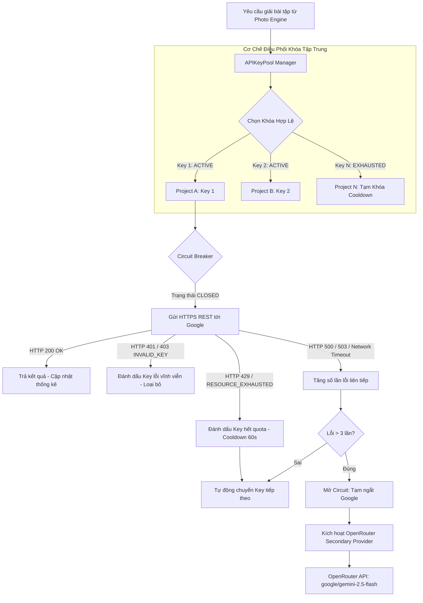

# THIẾT KẾ BỘ QUẢN LÝ KHÓA API TẬP TRUNG (API KEY POOL DESIGN)
## GOOGLE GEMINI & OPENROUTER RESILIENT PROVIDER ARCHITECTURE

*Mã tài liệu:* `API_KEY_POOL_DESIGN.md`  
*Mục tiêu:* Đảm bảo tính sẵn sàng cao (High Availability), tự phục hồi lỗi, quản lý hạn ngạch minh bạch và bảo mật thông tin xác thực.

---

## 1. NGUYÊN TẮC BẢO MẬT & TUÂN THỦ (COMPLIANCE & SECURITY)

1. **Tuân thủ điều khoản dịch vụ của Google Cloud & Gemini API:**
   - Hệ thống API Key Pool **KHÔNG ĐƯỢC PHÉP** sử dụng nhằm mục đích lách luật, gian lận quota, hay spam request vi phạm điều khoản dịch vụ (ToS) của Google.
   - Việc cấu hình nhiều Key phục vụ mục đích:
     - **Tính sẵn sàng cao (High Availability - HA):** Tránh gián đoạn khi một dự án Google Cloud gặp sự cố kỹ thuật hoặc bảo trì.
     - **Phân tách môi trường (Project Segregation):** Quản lý các dự án hợp lệ khác nhau của người dùng (ví dụ: Google AI Studio cá nhân, Google Cloud Console của trường học/lab nghiên cứu).
     - **Chuyển đổi dự phòng (Graceful Failover):** Tự động chuyển tiếp sang OpenRouter khi toàn bộ hạ tầng Google gặp sự cố mạng diện rộng.
2. **Bảo mật lưu trữ Key:**
   - **Tuyệt đối không hardcode API Key trong source code công khai hoặc bundle IPA**.
   - Phía Client iOS: Toàn bộ API Key được mã hóa và lưu trữ an toàn trong **iOS Keychain** thông qua `KeychainManager` với thuộc tính bảo mật `kSecAttrAccessibleAfterFirstUnlock`.
   - Giao diện người dùng cho phép thêm, xóa, kiểm tra tình trạng từng Key và gắn nhãn dự án.

---

## 2. KIẾN TRÚC MÔ-ĐUN API KEY POOL



---

## 3. STATE MACHINE CỦA TỪNG KHÓA (STATE MACHINE: ACTIVE -> RATE_LIMITED -> COOLDOWN -> INVALID)

Mỗi API Key trong Pool được điều khiển bởi một State Machine 4 trạng thái chặt chẽ theo chu trình:
```
       ┌───────────────────────────────┐
       ▼                               │
   [ACTIVE] ──(HTTP 429/Exhausted)──> [RATE_LIMITED]
       │                                       │
       │                                       ▼
       │                                  [COOLDOWN]
       │                                       │ (Hết thời gian Cooldown)
       │                                       └─────────────► [ACTIVE]
       │
       └──(HTTP 400/401/403/Revoked)──> [INVALID] (Vĩnh viễn)
```

| Trạng thái | Điều kiện kích hoạt & Ý nghĩa | Hành vi điều phối của Pool |
|---|---|---|
| `ACTIVE` | Khóa hợp lệ, sẵn sàng nhận request. | Được đưa vào danh sách xoay vòng (Round-Robin) phục vụ các lượt giải bài. |
| `RATE_LIMITED` | Gặp mã lỗi **HTTP 429** hoặc lỗi `RESOURCE_EXHAUSTED` từ Google API. | Lập tức rút khỏi vòng quay active, kích hoạt tính toán thời gian chờ dựa trên loại hạn ngạch (RPM hay RPD), sau đó chuyển tiếp sang `COOLDOWN`. |
| `COOLDOWN` | Khóa đang trong thời gian "nghỉ" chờ Google hoàn trả quota (60s đối với RPM, 6h/qua ngày đối với RPD). | Tạm ngừng phân phối, định tuyến request sang Key ACTIVE tiếp theo. Khi hết thời gian `cooldownUntil`, tự động phục hồi về `ACTIVE`. |
| `INVALID` | Lỗi xác thực vĩnh viễn (**HTTP 400/401/403**: API key bị xóa, sai key, project bị disable). | Khóa vĩnh viễn, đánh dấu đỏ trên UI Settings, loại bỏ hoàn toàn khỏi chu trình xoay vòng, không bao giờ thử lại. |

### Định nghĩa cấu trúc dữ liệu trong Swift:
```swift
struct KeyMetadata: Codable, Identifiable {
    let id: UUID
    let key: String
    var label: String
    var state: KeyState
    var totalRequests: Int
    var successfulRequests: Int
    var consecutiveFailures: Int
    var lastUsed: Date?
    var cooldownUntil: Date?
    
    enum KeyState: String, Codable {
        case active = "ACTIVE"
        case rateLimited = "RATE_LIMITED"
        case cooldown = "COOLDOWN"
        case invalid = "INVALID"
    }
}
```

---

## 4. CHIẾN LƯỢC QUẢN LÝ LỖI, RETRY & CIRCUIT BREAKER

### 4.1 Chiến lược Exponential Backoff với Jitter
- Không bao giờ retry vô hạn. Số lần thử lại tối đa cho 1 lượt giải toán: **3 lần**.
- Công thức thời gian chờ (Exponential Backoff với Jitter):
  $$T_{\text{wait}} = \min(T_{\text{max}}, T_{\text{base}} \times 2^{\text{attempt}}) \pm \text{RandomJitter}(0.1 \times T_{\text{wait}})$$
  - $T_{\text{base}} = 1.0\text{s}$, $T_{\text{max}} = 8.0\text{s}$.
  - Jitter ngẫu nhiên ngăn chặn hiện tượng "thundering herd" làm sập tiếp các khóa khác.

### 4.2 Cơ chế Circuit Breaker (Bộ ngắt mạch)
- **CLOSED (Bình thường):** Mọi request chuyển tới Google Gemini API.
- **OPEN (Ngắt mạch):** Khi xảy ra 5 lỗi mạng/server liên tiếp trên toàn bộ các Key Google trong 30 giây, Circuit Breaker chuyển sang trạng thái OPEN. Mọi request ngay lập tức được định tuyến sang **OpenRouter Fallback** mà không cần tốn thời gian timeout gọi lên Google.
- **HALF-OPEN (Thử nghiệm):** Sau 45 giây ở trạng thái OPEN, hệ thống cho phép 1 request duy nhất thử gọi lại Google. Nếu thành công, đóng mạch về CLOSED; nếu thất bại, tiếp tục OPEN trong 60 giây tiếp theo.

### 4.3 Khử trùng lặp Request (Idempotency & Deduplication)
- Mỗi bức ảnh bài tập được tạo mã băm SHA-256 (`imageHash`).
- Nếu người dùng bấm chụp liên tiếp trong vòng 3 giây mà `imageHash` giống hệt nhau: Hệ thống bỏ qua request thứ hai, trả về thông báo *"Đang giải bài toán trước đó, xin đợi..."*.

---

## 5. DỰ PHÒNG QUA OPENROUTER (SECONDARY PROVIDER)

Khi toàn bộ Key trong Google Gemini Pool đều rơi vào trạng thái `COOLDOWN` hoặc khi Circuit Breaker bật sang `OPEN`:
- **Endpoint:** `https://openrouter.ai/api/v1/chat/completions`
- **Model định tuyến:** `google/gemini-2.5-flash` hoặc `google/gemini-flash-1.5`
- **Headers:**
  ```http
  Authorization: Bearer <OPENROUTER_API_KEY>
  HTTP-Referer: https://openvision.internal
  X-Title: RayBan-Meta-Gemini-Solver
  Content-Type: application/json
  ```
- Định dạng payload tuân theo chuẩn OpenAI Vision schema với Base64 JPEG. Kết quả trả về được đưa qua bộ phân tích kênh đôi `DualChannelParser` để đồng bộ trải nghiệm với Google Gemini API gốc.
