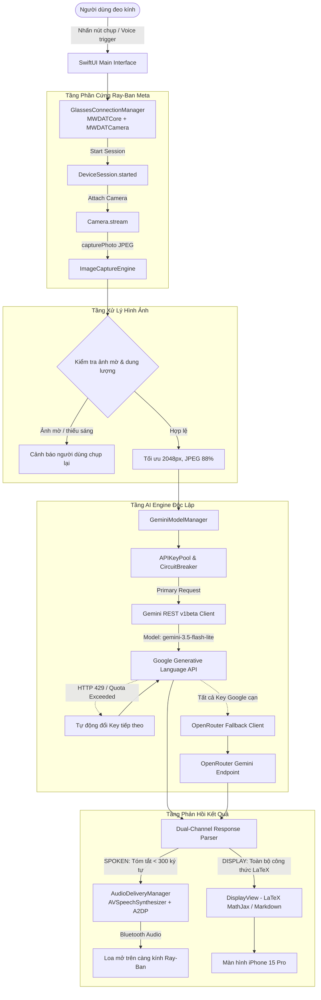

# QUYẾT ĐỊNH KIẾN TRÚC HỆ THỐNG (ARCHITECTURE DECISION)
## RAY-BAN META GEN 2 × GOOGLE GEMINI MATH SOLVER

*Mã tài liệu:* `ARCHITECTURE_DECISION.md`  
*Ngày phê duyệt:* 07/11/2026  
*Trạng thái:* Phê duyệt chính thức (Approved)

---

## 1. BỐI CẢNH VÀ BÀI TOÁN

Dự án yêu cầu một hệ thống hoàn chỉnh kết nối kính thông minh **Ray-Ban Meta Gen 2** với **iPhone 15 Pro** (UDID: `<UDID>`, iOS 18/26) để chụp ảnh bài tập từ camera của kính, gửi sang **Google Gemini API** giải đề theo System Prompt chuyên sâu, và trả kết quả chính xác, ngắn gọn qua loa kính đồng thời hiển thị chi tiết bài giải trên màn hình điện thoại.

### Ràng buộc phần cứng & hạ tầng:
- Thiết bị cá nhân: iPhone 15 Pro, kết nối USB với máy host Windows 11. Đã kiểm chứng nhận dạng tốt qua `pymobiledevice3`.
- Phần cứng kính: Ray-Ban Meta Gen 2 (BLE MAC: `<BLE_MAC>`).
- Meta Developer Credentials: App ID `306760944872162`, Client Token `AR|<META_APP_ID>|<CLIENT_TOKEN>`.
- Môi trường build iOS: Runner đám mây GitHub Actions `macos-26` với Xcode 26.6, công cụ XcodeGen tự động tạo file `.xcodeproj`.

---

## 2. PHÂN TÍCH VÀ ĐÁNH GIÁ 3 PHƯƠNG ÁN

```
+----------------------------------------------------------------------------------------------------+
|                                    MA TRẬN ĐÁNH GIÁ KIẾN TRÚC                                      |
+------------------------------+--------------------+-----------------------+------------------------+
| Tiêu chí                     | 1. Cải tiến Visor  | 2. Giữ OpenVision gốc | 3. Native Clean Solver |
+------------------------------+--------------------+-----------------------+------------------------+
| Tương thích iPhone 15 Pro    | KHÔNG (Android APK)| CÓ (Đã build được IPA)| CÓ (Swift/SwiftUI)     |
| Ổn định kết nối kính         | Kém (BLE DataX thô)| Cao (Meta DAT 0.9.0)  | Cao (Meta DAT 0.9.0)   |
| Độ nét ảnh bài tập toán      | Rất cao (Full-res) | Rất kém (Bị ép 512px) | Rất cao (2048px JPEG90)|
| Tốc độ xử lý AI              | Phụ thuộc PC       | Chậm (Live WebSocket) | Rất nhanh (<3s REST)   |
| Quản lý Model & Key Pool     | Trong script Py PC | Kém (1 Key, Hardcode) | Tập trung trong App    |
| Kích thước và hiệu năng App  | ~71 MB APK         | 49.6 MB IPA (Nặng MLX)| < 8 MB IPA (Tối giản)  |
| Khả năng bảo trì lâu dài     | Kém (Dễ gãy giao thức)| Trung bình (Quá rườm rà)| Xuất sắc (Rõ ràng, mô-đun)|
+------------------------------+--------------------+-----------------------+------------------------+
```

### Đánh giá phương án 1: Tiếp tục cải tiến Visor
- **Kết luận:** **LOẠI BỎ NGAY LẬP TỨC**.
- **Lý do:** Visor là ứng dụng Android. Không thể cài đặt file `.apk` lên iPhone 15 Pro của người dùng. Mọi nỗ lực duy trì Visor đều không giải quyết được mục tiêu sử dụng trên iPhone.

### Đánh giá phương án 2: Tái sử dụng nguyên vẹn OpenVision
- **Kết luận:** **KHÔNG ĐẠT YÊU CẦU NẾU KHÔNG CẢI TỔ TOÀN DIỆN**.
- **Lý do:** OpenVision gốc được thiết kế cho mục đích "trợ lý trò chuyện rảnh tay tổng quát" (chạy mô hình cục bộ nặng hàng gigabyte, streaming video liên tục). Việc stream video làm cạn pin kính trong 30 phút, ngốn băng thông và model cấu hình mặc định đã bị Google khóa 404. Độ phân giải 512px khiến bài toán bị mờ, không thể đọc được.

### Đánh giá phương án 3: Xây dựng Giải pháp iOS Native Chuyên Biệt (Streamlined Meta Solver)
- **Kết luận:** **LỰA CHỌN TỐI ƯU DUY NHẤT (SELECTED)**.
- **Lý do:**
  1. Kế thừa phần giao tiếp phần cứng vững chắc đã được kiểm chứng của Meta DAT SDK 0.9.0 từ OpenVision.
  2. Tái sử dụng hạ tầng build tự động trên GitHub Actions `macos-26`.
  3. **Loại bỏ triệt để các thư viện cồng kềnh:** Cắt bỏ hoàn toàn runtime suy luận on-device `mlx-swift` và bộ trọng số giọng nói `Kokoro TTS` (chiếm hơn 400MB RAM/dung lượng cài đặt), loại bỏ Silero và các backend phân tán (Hermes, Grok, OpenClaw). Quyết định này giúp giảm kích thước gói cài đặt, triệt tiêu nguy cơ iOS kill app do áp lực bộ nhớ (Jetsam memory pressure) và **tập trung 100% tài nguyên vào tốc độ giải toán bằng Google Gemini API**.
  4. Viết mới hoàn toàn mô-đun **Gemini Math Provider**: HTTPS REST v1beta với `gemini-3.5-flash-lite`, API Key Pool xoay vòng và fallback OpenRouter.
  5. Cải tổ **Image Capture Engine**: Tăng kích thước ảnh lên 2048px (JPEG 88%), có thuật toán kiểm tra ảnh mờ (Laplacian variance) và xoay chiều tự động.
  6. Tích hợp cơ chế **Dual-Channel Output**: Tách biệt rõ ràng âm thanh qua loa kính và văn bản hiển thị trên màn hình.

---

## 3. THIẾT KẾ KIẾN TRÚC HỆ THỐNG MỚI (CLEAN IOS SOLVER ARCHITECTURE)



---

## 4. CÁC QUY TẮC BẤT BIẾN CỦA KIẾN TRÚC MỚI (ARCHITECTURAL INVARIANTS)

1. **Không Hardcode Model:**
   - Tuyệt đối không hardcode chuỗi tên model phân tán trong code. Mọi tên model phải lấy từ `GeminiModelManager` với danh sách ưu tiên cấu hình động.
2. **Không Truyền Stream Video Liên Tục Cho Việc Giải Bài Tập:**
   - Camera trên kính chỉ được kích hoạt khi có yêu cầu giải đề, chụp 1 ảnh tĩnh native JPEG độ phân giải cao (2048px) rồi giải phóng luồng camera để bảo tồn pin kính và băng thông.
3. **Cơ Chế Phản Hồi Kênh Đôi (Dual-Channel Guarantee):**
   - Tai nghe/loa kính: Chỉ đọc câu trả lời trực tiếp (kết quả số, đáp án trắc nghiệm A/B/C/D) dưới 300 ký tự, không đọc công thức LaTeX loằng ngoằng.
   - Màn hình iPhone: Hiển thị lời giải chi tiết từng bước với đầy đủ ký hiệu toán học chuẩn xác.
4. **Bảo Mật API Key Tuyệt Đối:**
   - Không commit API Key lên public GitHub. Trong ứng dụng, API Key được quản lý tập trung trong `APIKeyPool`, lưu trữ an toàn trong iOS Keychain và cho phép người dùng nhập/sửa danh sách key từ giao diện Settings.
5. **Khả Năng Chịu Lỗi Cao (High Resilience):**
   - Tự động nhảy sang Key tiếp theo khi gặp mã lỗi 429 (Rate Limit) hoặc `RESOURCE_EXHAUSTED`.
   - Có cơ chế ngắt mạch (Circuit Breaker) ngăn chặn việc gửi request dồn dập vào endpoint bị sập.
   - Tự động chuyển đổi sang nhà cung cấp phụ (OpenRouter) khi toàn bộ Key Google gặp sự cố.
