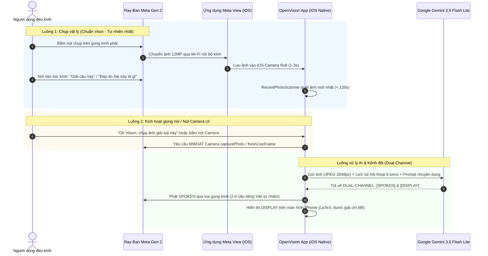

# MASTER HANDOVER BLUEPRINT: RAY-BAN META GEN 2 × GOOGLE GEMINI AI (OPENVISION SOLVER)
> **Tài liệu chuyển giao kỹ thuật toàn diện dành cho Kỹ sư AI / Lập trình viên tiếp quản dự án**
> Phiên bản: **Release v5 (Visor Parity)** | Cập nhật: **Tháng 11/2026**

---

## 1. TỔNG QUAN DỰ ÁN & MỤC TIÊU BẤT DI BẤT DỊCH (CORE MISSION)

### 1.1. Bản sắc dự án (Project Identity)
Biến kính thông minh **Ray-Ban Meta Gen 2** kết hợp **iPhone 15 Pro** thành một **thiết bị giải bài tập, thi cử và hỗ trợ tư duy POV thời gian thực** mạnh mẽ bằng **Google Gemini API**, hoàn toàn thay thế trợ lý Meta AI mặc định.

### 1.2. Ba nguyên tắc cấm kỵ (Non-Negotiables)
1. **KHÔNG** biến dự án thành chatbot văn bản thuần túy độc lập trên màn hình. Kính Ray-Ban Meta là thiết bị phần cứng chính, camera POV là giác quan thu nhận, loa thái dương là kênh phát kết quả.
2. **KHÔNG** phụ thuộc vào Meta AI để giải toán (Meta AI bị giới hạn vùng, kiểm duyệt khắt khe, không hỗ trợ nhận dạng công thức toán học chuyên sâu).
3. **KHÔNG** làm mất khả năng tương tác rảnh tay (Hands-free POV): người dùng chỉ cần nhìn đề bài, chụp và hỏi tự nhiên.

---

## 2. QUY TRÌNH HOẠT ĐỘNG LÝ TƯỞNG (THE IDEAL END-TO-END WORKFLOW)



### 2.1. Luồng Người Dùng Chính (Primary Shutter Workflow):
1. Người dùng nhìn vào đề bài / trang sách / màn hình máy tính.
2. Bấm nút chụp trên gọng kính phải. Ứng dụng Meta View tự động đồng bộ ảnh 12MP về Camera Roll của iPhone.
3. Người dùng gọi *"Ok Vision"* rồi nói **tự do, tiếng Việt hoặc tiếng Anh** (*"Giải câu này"*, *"Câu 3 chọn gì?"*, *"What does this say?"*…). **Không có danh sách câu cố định** — Gemini nhận nguyên văn và tự hiểu ý.
4. `RecentPhotoScanner` (`PHPhotoLibrary`) đã **tải trước** ảnh ngay khi Meta View đồng bộ về (ảnh **gốc 12MP**, ngoài main thread), gán vào ngữ cảnh đàm thoại (`CapturedPhotoContext`, 120 giây / 5 câu hỏi).
5. `VoiceAgentViewModel` gửi ảnh + câu hỏi nguyên văn lên Google Gemini 3.5 Flash Lite qua REST **streaming (SSE)**; kính bắt đầu đọc ngay khi câu SPOKEN đầu tiên về tới.
6. Gemini phân tích và trả về định dạng **Kênh Đôi (Dual-Channel)**:
   - **Kênh SPOKEN**: 2 đến 4 câu văn tiếng Việt có dấu, đọc to rõ ràng phương pháp, bước tính chính và đáp án qua loa thái dương của kính.
   - **Kênh DISPLAY**: Lời giải chi tiết từng bước có công thức toán học LaTeX chuẩn (`$...$`, `$$...$$`) hiển thị trên màn hình iPhone.
7. Người dùng có thể hỏi tiếp các câu nối tiếp (*"Tại sao lại ra x = 2?"*, *"Còn câu 2 thì sao?"*) trong vòng 120 giây mà không cần chụp lại ảnh (`conversationHistory` giữ ngữ cảnh, ảnh không bị upload lại). Câu hỏi không liên quan tới ảnh (*"Thủ đô của Pháp?"*) được trả lời bình thường.
8. Trả lời luôn theo **ngôn ngữ người hỏi**; giọng đọc tự chọn theo ngôn ngữ câu trả lời. Nếu mạng lỗi sau khi đã retry, **kính nói ra lỗi** (không im lặng).

---

## 3. CÁC LỖI TỬ HUYỆT ĐÃ KHẮC PHỤC & BÀI HỌC KIẾN TRÚC (FATAL PITFALLS RESOLVED)

Bất kỳ AI nào tiếp quản **BẮT BUỘC** phải đọc kỹ 7 bài học kỹ thuật này để không phạm lại sai lầm làm hỏng app:

### ⚠️ Bài học 1: Đứng / Treo toàn bộ App khi ghi âm (Audio Deadlock)
- **Nguyên nhân**: Trong iOS CoreAudio `mediaserverd`, hai `AVAudioEngine` độc lập **KHÔNG THỂ** cùng cài đặt `installTap(onBus: 0)` trên `inputNode`. Bản gốc có `SessionRecorder` tự tạo engine riêng trong khi `VoiceCommandService` đang sở hữu bus 0, gây ra exception không bắt được hoặc Mach IPC deadlock làm đơ hoàn toàn giao diện.
- **Giải pháp**: Triển khai kiến trúc **Shared Audio Tap**. Chỉ một engine duy nhất của `VoiceCommandService` sở hữu microphone tap, buffer âm thanh được forward an toàn sang `SessionRecorder.shared.appendAudioBuffer(buffer)`.

### ⚠️ Bài học 2: Nút âm lượng nhảy loạn / Loa kính kêu click (Volume HUD Flapping)
- **Nguyên nhân**: Hệ điều hành iOS chia riêng 2 miền âm lượng: *Media Volume (A2DP stereo)* và *Call Volume (HFP SCO đàm thoại)*. Khi app liên tục thay đổi category giữa `.playback` và `.playAndRecord` hoặc đổi mode từ `.voiceChat` sang `.default`, iOS liên tục giật thanh âm lượng và tạo tiếng click ở loa kính.
- **Giải pháp**: Cố định Audio Category duy nhất `.playAndRecord` với `mode: .default` và các tùy chọn: `[.mixWithOthers, .allowBluetoothHFP, .allowBluetoothA2DP, .defaultToSpeaker]`. Xóa bỏ đệ quy `setPreferredInput(nil)` trong `handleAudioRouteChange`.

### ⚠️ Bài học 3: Gọi Agent qua kính không ăn (Microphone kính bị lờ)
- **Nguyên nhân**: App bị ép ưu tiên mic iPhone (`setPreferredInput(nil)`) khi khởi động trước khi kênh Bluetooth HFP đàm thoại của kính Ray-Ban hoàn tất bắt tay (SCO negotiation). Thêm vào đó, Speech Recognizer tiếng Việt không nhận diện được chữ tiếng Anh "Ok Vision".
- **Giải pháp**:
  - Tự động dò quét và bind ngay cổng `bluetoothHFP` của Ray-Ban Meta khi có sự kiện kết nối phần cứng (`.newDeviceAvailable`).
  - Bổ sung các biến thể ngữ âm tiếng Việt vào `VoiceCommandService`: `"ô kê vi dơn"`, `"ok vi dơn"`, `"vi dơn"`, `"vision"`.

### ⚠️ Bài học 4: Đang trả lời 2-3 giây thì tắt ngúm (TTS Echo False Barge-in)
- **Nguyên nhân**: Loa gọng kính phát ra bị mic gọng kính thu ngược lại. Khi app gửi yêu cầu phát TTS, có độ trễ 150-300ms hệ điều hành mới bắt đầu phát. App tưởng là rảnh rỗi nên mở mic, mic nghe tiếng loa kính đọc, tưởng người dùng ra lệnh mới nên kích hoạt lệnh dừng TTS (`ttsService.stop()`).
- **Giải pháp**:
  - Gán ngay `agentState = .speaking` và `voiceCommandService.isBargeInPaused = true` đồng bộ trước khi enqueue âm thanh.
  - Mic **chỉ được mở lại** khi delegate `speechSynthesizer didFinish` phát xong câu cuối cùng, cộng thêm độ trễ an toàn **350ms** để triệt tiêu tiếng vang trong phòng.

### ⚠️ Bài học 5: Trả mấy trăm chữ đọc được có mấy chữ (TTS Truncation)
- **Nguyên nhân**:
  1. System Prompt cũ ép: *"Ultra-concise under 250 characters state final answer directly without filler"*, khiến Gemini chỉ trả về đúng 3 từ: `SPOKEN: X bằng 2.`
  2. Hàm tách chuỗi dùng `lower.range(of: "display")` nên nếu trong câu nói có chữ "display" hoặc mã LaTeX `\displaystyle`, toàn bộ phần sau bị chặt cụt.
- **Giải pháp**:
  - Cải tổ System Prompt: Yêu cầu giải thích tự nhiên 2-4 câu đầy đủ bằng tiếng Việt có dấu, nêu rõ phương pháp, bước giải và đáp số.
  - Sử dụng biểu thức chính quy **Line-anchored Regex của Visor** để bóc tách thẻ `SPOKEN` và `DISPLAY`.
  - Bộ lọc `cleanSpokenAudio`: Gọt sạch các ký tự LaTeX (`$`, `\frac`, `\sqrt`) trước khi đưa vào giọng đọc Apple để không bị khựng chữ.

### ⚠️ Bài học 6: Tính năng Upload ảnh không hoạt động (Thiếu PHPhotoLibrary)
- **Nguyên nhân**: Apple Sandbox trên iOS chặn các kết nối Bluetooth RFCOMM độc quyền của Meta mà Visor Android từng dùng. Khi người dùng bấm nút chụp trên kính, Meta View tải ảnh về Camera Roll, nhưng OpenVision không hề có code đọc thư viện ảnh Photos.
- **Giải pháp**: Tạo module `RecentPhotoScanner` (`PHPhotoLibraryChangeObserver` & `PHAsset`) tự động lấy ảnh mới nhất chụp trong vòng 120 giây (chuẩn Visor `hasRecentShutterPhoto`).

### ⚠️ Bài học 7: Mất ngữ cảnh khi hỏi câu tiếp theo (Stateless REST)
- **Nguyên nhân**: `GeminiLiveService.sendRESTMessage` trước đây chỉ gửi duy nhất turn hiện tại (`contents: [[ "role": "user", "parts": parts ]]`).
- **Giải pháp**: Bổ sung mảng `conversationHistory` lưu trữ 6 turns (3 lượt hỏi - đáp) kèm inlineData thumbnail để Gemini nhớ bức ảnh và câu hỏi trước đó.

---

## 4. BẢN ĐỒ MÃ NGUỒN CỐT LÕI (CODEBASE ARCHITECTURE)

| File Đường Dẫn | Trách Nhiệm Kỹ Thuật Chính |
| :--- | :--- |
| `OpenVision/Views/VoiceAgent/VoiceAgentViewModel.swift` | **Bộ điều phối trung tâm (Master Orchestrator)**: Quản lý vòng đời session, tích hợp `RecentPhotoScanner`, từ điển 40+ từ khóa câu hỏi thị giác (`visualKeywords`), bộ đệm ảnh `CapturedPhotoContext` (120s TTL), cơ chế chống False Barge-in, giảm timeout chụp kính xuống 1.5s, Visual Error Guard. |
| `OpenVision/Services/GeminiLive/GeminiLiveService.swift` | **Engine AI Gemini**: Quản lý API Key Pool rotation, System Prompt kênh đôi, bộ bóc tách Regex line-anchored `parseDualChannel`, bộ sinh tóm tắt `generateSpokenSummary`, bộ nhớ đệm `conversationHistory` (6 turns). |
| `OpenVision/Services/TTS/TTSService.swift` | **Dịch vụ Giọng nói**: Quản lý `AVSpeechSynthesizer`, bộ lọc `cleanSpokenAudio` (loại bỏ LaTeX và markdown), cờ `isSpeaking` đồng bộ, bộ đếm `pendingUtterances`, callback `onSpeechEnded`. |
| `OpenVision/Services/Audio/AudioSessionManager.swift` | **Quản lý Audio Session**: Cố định category `.playAndRecord`, chống giật Volume HUD, định tuyến mic Bluetooth HFP kính Ray-Ban Meta. |
| `OpenVision/Services/Voice/VoiceCommandService.swift` | **Nhận diện Giọng nói & Wake Word**: Sở hữu duy nhất tap Bus 0 trên `AVAudioEngine`, từ khóa tiếng Việt (`ô kê vi dơn`, `dừng lại`). |
| `PhotoPayload` / `SolverIntent` (trong `VoiceAgentViewModel.swift`) | Ảnh full-res (JPEG gốc đi nguyên byte; HEIC/xoay EXIF mã hóa lại 1 lần), bản 2048px cho lịch sử; các quy tắc thuần: TTL ảnh, lệnh dừng song ngữ, thông báo lỗi theo ngôn ngữ, backend nào tự hiểu ý (`modelDecidesIntent`). |
| `GeminiLiveService` – tầng mạng | SSE streaming, retry theo loại lỗi (429 → đổi key; key hỏng → loại 1 giờ; 5xx → backoff + jitter; rớt mạng → thử lại hoặc giữ phần đã nhận), deadline tổng 120s, `mediaResolution: HIGH` (tự bỏ nếu model không hỗ trợ), `maxOutputTokens` 8192. |
| `OpenVision/Resources/Info.plist` | **Quyền Hệ thống**: `NSPhotoLibraryUsageDescription`, `NSMicrophoneUsageDescription`, `NSCameraUsageDescription`, `NSBluetoothAlwaysUsageDescription`. |

---

## 5. THIẾT KẾ SYSTEM PROMPT & DUAL-CHANNEL FORMAT

Khi giao tiếp với Google Gemini, System Prompt phải luôn tuân thủ cấu trúc sau:

```
You are an expert AI professor and STEM/math solver integrated directly into Ray-Ban Meta Gen 2 smart glasses and iPhone. You can see what the user sees through their camera (textbooks, math problems, exams, computer screens, code).

HOW THE USER TALKS TO YOU: free speech in Vietnamese or English (from speech recognition — expect typos).
ALWAYS answer in the language the user used in their latest message.

PHOTOS: an attached image is the photo just taken with the glasses' capture button. Use it when the
question could be about it; ignore it for clearly unrelated questions; if the user asks about what they
see and there is no image in the conversation, say no photo was found and ask them to press the capture button.

When solving problems or answering questions, you MUST strictly follow the DUAL-CHANNEL RESPONSE FORMAT:

SPOKEN:
Provide a natural, comprehensive spoken explanation in 2 to 4 complete sentences for the Ray-Ban Meta smart glasses speaker. State the core method, key calculation steps, and the final answer clearly and confidently in natural Vietnamese (tiếng Việt có dấu đầy đủ, chuẩn xác). Then briefly mention that the complete derivation is shown on the phone screen.
NEVER use raw LaTeX formulas, backslashes, or math symbols (no dollar signs, frac, sqrt, subscripts). Spell out math naturally (ví dụ: 'x bằng 2', 'tích phân từ 0 đến 1', 'đáp án là A').
For multiple choice questions, explicitly state the question number and the selected option with brief reasoning.

DISPLAY:
Complete step-by-step solution for the iPhone screen. Use standard LaTeX ($...$ inline, $$...$$ block display) for all formulas. Provide clear derivations, explanations, and final answer. If multiple choice, clearly state the selected option and rationale.
```

---

## 6. QUY TRÌNH BUILD & DEPLOYMENT

### 6.1. CI/CD Tự động trên GitHub Actions
- Repository: `https://github.com/darwnlinz1/OpenVision`
- Workflow: `.github/workflows/build-ipa.yml` (chạy trên runner `macos-26-arm64`).
- Trigger: Tự động khi push lên nhánh `main` hoặc kích hoạt thủ công qua `workflow_dispatch`.
- Output: Artifact `OpenVision-unsigned` chứa `OpenVision.ipa`.

### 6.2. Cài đặt lên iPhone 15 Pro qua Sideloadly
1. Cắm cáp kết nối iPhone 15 Pro với máy tính Windows/Mac.
2. Mở phần mềm **Sideloadly**.
3. Kéo thả file `OpenVision.ipa` vào Sideloadly.
4. Nhập Apple ID (`<Apple ID của bạn>`).
5. Bấm **Start** để ký chứng chỉ cá nhân và cài đặt ứng dụng vào máy.
6. Trên iPhone, vào **Cài đặt -> Cài đặt chung -> Quản lý VPN & Thiết bị** -> Bấm Tin cậy nhà phát triển.

---

## 7. CHECKLIST KIỂM THỬ CHO KỸ SƯ KẾ NHIỆM

> **Tự động hóa:** phần lớn checklist này giờ chạy tự động — `make blueprint-check` (guard tĩnh, vài giây), `make e2e` (XCTest trên Simulator iOS 18+), `make e2e-live` (Gemini thật), và Test 6 trong workflow *Build Unsigned IPA*. Ma trận truy vết đầy đủ và quy trình trên phần cứng thật (H1–H8): [`docs/testing/E2E_TEST_PLAN.md`](docs/testing/E2E_TEST_PLAN.md).

Khi tiếp quản và phát triển tính năng mới, bắt buộc phải kiểm tra qua 6 bài test này trước khi giao sản phẩm:

- [ ] **Test 1**: Bấm nút chụp vật lý trên gọng kính phải -> Đợi 2 giây -> Nói "Giải câu này" -> App phải tự lấy ảnh từ Photos gửi Gemini, không được báo lỗi thiếu ảnh.
- [ ] **Test 2**: AI đọc đáp số qua loa gọng kính trong 5-10 giây liên tục không bị ngắt giữa chừng.
- [ ] **Test 3**: Nút âm lượng trên iPhone không bị giật, loa kính không phát tiếng click lặp đi lặp lại.
- [ ] **Test 4**: Nói câu hỏi tiếp nối ("Tại sao lại ra kết quả đó?") trong vòng 60 giây -> Gemini phải trả lời dựa trên ngữ cảnh bài toán trước.
- [ ] **Test 5**: Cố tình hỏi câu hỏi thị giác khi chưa chụp ảnh -> Kính phải nói không tìm thấy ảnh và nhắc bấm nút chụp (bằng ngôn ngữ người hỏi). *(Cập nhật: do Gemini tự nhận biết, không còn dựa vào danh sách câu cố định; câu hỏi không liên quan tới ảnh vẫn được trả lời bình thường.)*
- [ ] **Test 6**: File IPA sau khi build xong phải trích xuất kiểm tra binary Mach-O có đầy đủ các symbol: `RecentPhotoScanner`, `cleanSpokenAudio`, `conversationHistory` (+ `PhotoPayload`, `streamGenerateContent`, `SolverIntent`). Tự động: `scripts/blueprint/verify_ipa_symbols.sh`.
- [ ] **Test 7**: Hỏi bằng tiếng Anh sau khi chụp -> trả lời và đọc bằng tiếng Anh.
- [ ] **Test 8**: Mạng yếu -> hoặc có câu trả lời, hoặc kính nói "Mạng đang chậm…" trong ≤ 2 phút; không bao giờ treo "Thinking…".
