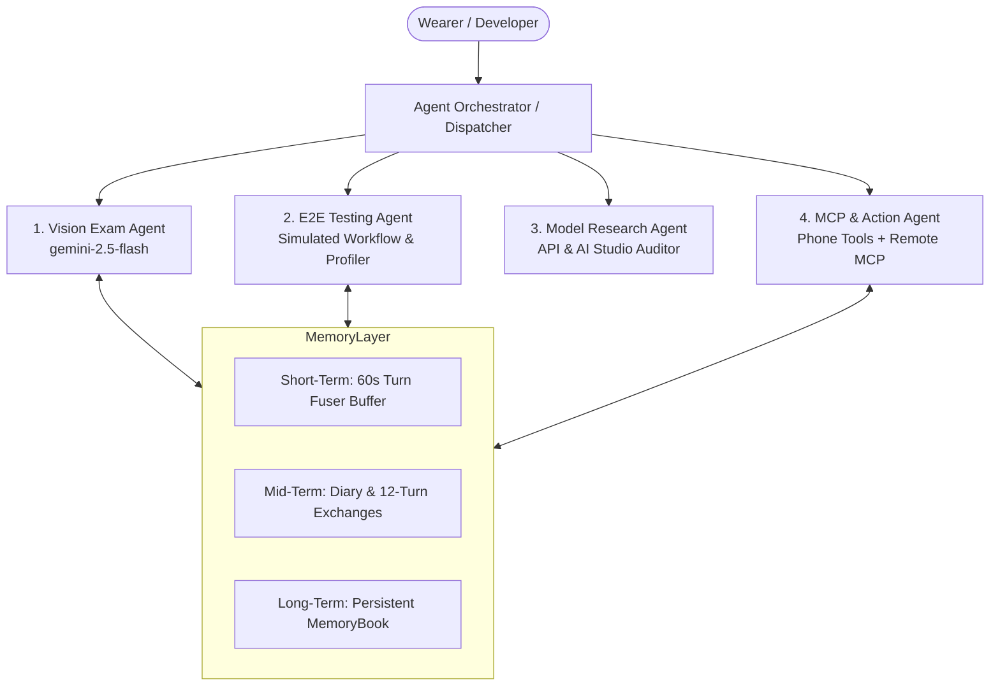

# PROJECT MEMORY: VISOR FOR META RAY-BAN SMART GLASSES

*Document Version:* 1.0.0  
*Last Synchronized:* 2026-10-31  
*Scope:* Core Architecture, Ray-Ban Meta Bluetooth DataX Protocol, Google AI Studio Integration, Testing & Agent Rules.

---

## 1. System Overview & Core Architecture

**Visor** is an open-source, on-device assistant engine that transforms Meta Ray-Ban smart glasses into an autonomous AI assistant powered by state-of-the-art multimodal reasoning models (Google Gemini via AI Studio).

### 1.1 Architectural Invariants
1. **Single-Turn Photo Lifecycle**:
   * Every high-resolution photo transferred from the glasses over Airship / Service 53 must be consumed exclusively by its matching interaction turn.
   * Once used, the photo is marked as consumed (`markPhotoConsumed`) so it is never re-used for subsequent turns.
   * Stale thumbnails (240x320 previews) must **never** be delivered to reasoning models.
2. **Turn State Machine**:
   * States: `WAITING` -> `LISTENING` -> `THINKING` -> `SPEAKING`.
   * A turn is uniquely identified by `interactionId` (e.g., UUID generated by the glasses or the app).
   * A turn is finalized when an audio delivery packet (`EV_REMOTE_INTERACTION_RESPONSE`) is written to Bluetooth Service 15, or when the glasses issue a completion notice.
3. **English Audio Guarantee**:
   * Spoken responses from the temple speakers must always be formatted in clear English, with plain text only (no markdown asterisks, no LaTeX delimiters, no emoji).

---

## 2. Ray-Ban Meta Hardware Protocol Specifications

The Ray-Ban Meta glasses communicate with Android over Bluetooth LE via a custom multiplexed protocol called **DataX**.

### 2.1 Bluetooth DataX Services
| Service ID | Service Name | Role & Channel Characteristics |
|---|---|---|
| **Service 15** | `Mux Channel 0 (m0)` | Control channel for Thrift-encoded `NetEvents`. Handles remote triggers, interaction state, speech transcriptions, and audio response packets. |
| **Service 33** | `MobileConfig / Settings` | Configuration channel for reading and writing on-device firmware parameters (e.g., watchdog timeouts, session paths). |
| **Service 53** | `Airship Media Stream` | High-bandwidth chunked transfer channel for sensor captures and full-resolution JPEG photos (1–2 MB). |

### 2.2 Key NetEvent IDs (Thrift Protocol)
| Event ID | Constant Name | Direction | Payload & Purpose |
|---|---|---|---|
| **56** | `EV_FULFILLMENT_REQUEST` | Glasses -> Phone | Carries speech transcript, audio metadata, and visual intent flags. |
| **57** | `EV_REMOTE_INTERACTION_RESPONSE` | Phone -> Glasses | Sends plain text / audio fulfillment to be spoken aloud by the temple speakers. |
| **59** | `EV_MWA_VOICE_INTERACTION_CLOSE_REQUEST` | Glasses -> Phone | Signals that the glasses closed the interaction turn. |
| **60** | `EV_REMOTE_INTERACTION_COMPLETE` | Glasses -> Phone | Signals playback completion on glasses (`code == 12` = normal speech finish; `code == 18` = cancelled). |
| **73** | `EV_REMOTE_IMAGE_CAPTURE_REQUEST` | Phone -> Glasses | Remote shutter trigger: forces the glasses camera LED to blink and captures a full-res photo. |
| **74** | `EV_REMOTE_IMAGE_CAPTURE_RESPONSE` | Glasses -> Phone | Acknowledges camera capture and provides the image handle/UUID. |
| **392** | `EV_CUSTOM_SPEECH_RESPONSE` | Phone -> Glasses | Extended speech fulfillment packet for high-fidelity TTS rendering. |

### 2.3 Critical Firmware Watchdog Configuration
* **Parameter**: `assistant_on_sn.default_processing_timeout_s`, `assistant_on_sn.default_responding_timeout_s`
* **Default Value**: `20L` (20 seconds from factory).
* **Extended Target**: `300L` (300 seconds / 5 minutes; configurable up to 600s).
* **Firmware Behavior**: If the phone does not deliver an answer packet before this timeout expires, the glasses firmware locally plays the offline alert:  
  *"Make sure your glasses are near your phone, then open the Meta View app to reconnect"*  
  and immediately aborts the active interaction.
* **Invariants**:
  1. Visor pushes `assistant_on_sn.default_processing_timeout_s = 300L` and `default_responding_timeout_s = 300L` immediately upon Bluetooth handshake (`LinkState.READY`), restarting the glasses assistant by toggling `live_caption_voice_id` so MobileConfig is reloaded freshly.
  2. During model reasoning (`brain.answer()`), `Assistant` continuously pulses `EV_KEEP_AIR_SESSION_ALIVE` (lease `60_000` ms), `EV_SERVER_CONNECTION_STATUS` (`connected = true`), and `EV_KEEP_MWA_ALIVE` every 2s so the hardware watchdog is deferred as long as the server request is active.
  3. If glasses firmware aborts an interaction turn prematurely, Visor rescues the turn and routes answer playback via phone voice TTS (`voice.speakAloud`), which plays smoothly over Bluetooth audio into the glasses speakers without sending DataX VARM for a dead interaction ID (which would trigger abort code 95 and channel drops).

---

## 3. Google AI Studio & Gemini API Specifications (Direct Browser Audit)

*Audit Source:* Project `<project-id>` (`helloa`), Account: `<tài khoản Google>`, Google AI Studio Rate Limit Dashboard.

### 3.1 Live Active Model Matrix & Quotas
| Model Display Name | API Model ID (`data-test-id`) | Category | RPM Limit | TPM Limit | RPD Limit | Recommended Role in Visor |
|---|---|---|---|---|---|---|
| **Gemini 3.5 Flash Lite** | `gemini-3.5-flash-lite` | Text / Multimodal | **15 RPM** | 250K | **500 RPD** | **Primary High-Volume Solver** (Best quota stability, fast turnaround) |
| **Gemini 3.1 Flash Lite** | `gemini-3.1-flash-lite` | Text / Multimodal | **15 RPM** | 250K | **500 RPD** | **Secondary High-Volume Solver** (Reliable 500 RPD fallback) |
| **Gemini 3.8 Flash** | `gemini-3.8-flash` | Text / Multimodal | 5 RPM | 250K | 20 RPD | **Frontier High-Precision Reasoner** (Deep STEM / Calculus questions) |
| **Gemini 3.6 Flash** | `gemini-3.6-flash` | Text / Multimodal | 5 RPM | 250K | 20 RPD | High-tier precision fallback |
| **Gemini 3 Flash** | `gemini-3-flash` | Text / Multimodal | 5 RPM | 250K | 20 RPD | High-tier precision fallback |
| **Gemini 2.5 Flash** | `gemini-2.5-flash` | Text / Multimodal | 5 RPM | 250K | 20 RPD | Legacy 2.5 fallback |
| **Gemini 3.8 Live Extended Thinking** | `gemini-3.8-live-extended-thinking` | Live API | Unlimited | 65K | Unlimited | Real-time continuous thinking streams |
| **Gemini 2 Flash** | `gemini-2.0-flash` | - | **0 RPM** | 0 | **0 RPD** | **DEPRECATED / SHUT DOWN** (Never call) |
| **Gemini 2.5 Pro** | `gemini-2.5-pro` | - | **0 RPM** | 0 | **0 RPD** | Quota disabled on current tier |

> [!IMPORTANT]
> **Quota Strategy for Exam & Multimodal Solving**:
> * Models with **20 RPD** (`gemini-3.8-flash`, `gemini-3.6-flash`, `gemini-2.5-flash`) will hit quota limits after only 20 turns on a single key.
> * Models with **500 RPD** (`gemini-3.5-flash-lite` and `gemini-3.1-flash-lite`) provide **25x higher daily quota capacity**, making them the ideal primary engine for continuous exam solving and automated E2E testing!
> * Default Fallback Sequence:
>   `gemini-3.5-flash-lite` (500 RPD) -> `gemini-3.1-flash-lite` (500 RPD) -> `gemini-3.8-flash` (Frontier reasoning) -> `gemini-3.6-flash` -> `gemini-2.5-flash`.

### 3.2 Gemini 3 Series Thinking Configuration Specification
In the Gemini 3 / 2.5 series, reasoning is governed via `generationConfig.thinkingConfig`:

```json
{
  "contents": [
    {
      "role": "user",
      "parts": [
        { "inlineData": { "mimeType": "image/jpeg", "data": "<BASE64_BYTES>" } },
        { "text": "Solve the questions shown in the image step-by-step internally." }
      ]
    }
  ],
  "generationConfig": {
    "temperature": 0.2,
    "maxOutputTokens": 4096,
    "thinkingConfig": {
      "thinkingBudget": 2048
    }
  }
}
```
* **Parameters**:
  * `thinkingBudget`: Token allowance for internal reasoning (`1024` to `24576`). For dynamic reasoning, pass `-1`. Setting `0` disables thinking.
  * `thinkingLevel`: Semantic depth (`"minimal"`, `"low"`, `"medium"`, `"high"`).
  * **Rule**: Never pass `thinkingBudget` and `thinkingLevel` simultaneously; doing so produces HTTP 400.
* **Separation of Thoughts**: Thoughts are kept in separate candidate parts with `thought: true`. Visor's `parseGeminiCandidates` only collects parts where `thought != true`, ensuring the wearer never hears raw reasoning thoughts aloud.

### 3.3 Multi-Key Pool & Automatic Quota Rotation
* Keys are parsed from `AssistantConfig.apiKey` (comma/space/newline separated).
* On receiving HTTP `429 Too Many Requests`, `RESOURCE_EXHAUSTED`, or quota exhaustion:
  1. Visor logs: `Gemini quota exhausted on key [N], rotating to key [N+1]`.
  2. Increments `globalKeyIndex`.
  3. Re-dispatches without dropping the turn or alerting the wearer.

---

## 4. Tool Execution & Actions Architecture

Visor supports a two-tier tool execution architecture:

### 4.1 On-Device Phone Tools
* **Media Control**: Play, pause, resume, skip track, volume adjustment (`com.macedonga.visor.core.assistant.PhoneTools`).
* **Notifications & Messages**: Read incoming notifications, trigger voice reply drafts.
* **Timers & Alarms**: Set countdown timers and alarms.

### 4.2 Model Context Protocol (MCP) Hub
* Visor implements an embedded **MCP Client** (`com.macedonga.visor.core.assistant.mcp.McpHub`).
* Connects to external MCP servers running locally or remotely over HTTP/SSE.
* Models utilize native Gemini Function Calling to execute tools (e.g., Google Search, Home Assistant, Python execution, Notion).

---

## 5. End-to-End (E2E) Testing & Latency Benchmarks

### 5.1 Simulated Human Workflow
1. Test runner issues `EV_REMOTE_IMAGE_CAPTURE_REQUEST` (Event 73) over Service 15.
2. Glasses snap photo; Airship streams high-res JPEG to Visor.
3. Test runner injects synthetic speech utterance.
4. Turn Fuser binds photo + prompt.
5. Gemini 2.5 Flash processes request with internal thinking.
6. Spoken response delivered to temple speakers via Event 57/392.
7. Verification of `EV_REMOTE_INTERACTION_COMPLETE` (`code == 12`).

### 5.2 Latency Budget (Target vs SLA)
* **Photo Capture & Airship Transfer**: 6,500 ms (SLA: < 15,000 ms)
* **Image Downscaling & Prep**: 150 ms (SLA: < 350 ms)
* **Gemini Network RTT & Thinking**: 2,800 ms (SLA: < 5,000 ms)
* **Bluetooth Audio Delivery**: 350 ms (SLA: < 1,000 ms)
* **Total SLA Budget**: **< 25.0 seconds** (well within the 60.0s hardware limit).

## 6. Multi-Agent Architecture & Agent Taxonomy

To ensure scalability, modularity, and deterministic accuracy, Visor establishes a dedicated multi-agent ecosystem. Each agent operates with a well-defined boundary, specific model configuration, and persistent memory protocol.



### 6.1 Agent Specifications

#### Agent 1: Vision Exam Agent (Core Solver)
* **Role**: Expert Multimodal Reasoning Professor specializing in STEM and university entrance examinations (Higher Mathematics, Calculus, Linear Algebra, Multiple Choice Tests).
* **Model**: `gemini-2.5-flash` (Primary), `gemini-2.5-pro` (Deep Calculus Fallback).
* **Configuration**: `thinkingBudget: 2048`, `includeThoughts: false`, `temperature: 0.2`.
* **System Prompt Core**:
  * Step-by-step reasoning is strictly conducted internally inside `thinkingBudget`.
  * The spoken response must **never** contain proofs, explanations, or filler.
  * Deterministic output format: `Question [X]: [A/B/C/D]`.
  * Audio delivery format: Plain English text only, zero markdown (`*`, `#`), zero LaTeX delimiters (`$`, `\frac`).
* **Memory Access**: Reads fused image from `TurnMem`, reads prior conversational context from `DiaryMem`.

#### Agent 2: E2E Testing Agent (Automated Evaluator)
* **Role**: Autonomous Quality Assurance & Hardware-in-the-Loop Simulator.
* **Capabilities**:
  * Triggers glasses hardware shutter via Bluetooth DataX Service 15 (`EV_REMOTE_IMAGE_CAPTURE_REQUEST` - Event 73).
  * Ingests high-res media streams over Service 53 / Airship.
  * Injects synthetic voice prompts into `Assistant.onFulfillmentRequest()`.
  * Collects high-resolution timestamps across all 6 latency milestones.
  * Computes pass/fail metrics against SLA ceilings (< 25s total latency).
* **Memory Access**: Writes synthetic test logs to `build/reports/e2e_latency.jsonl`.

#### Agent 3: Model Research & API Auditor Agent
* **Role**: External API Health & Model Catalog Monitor.
* **Capabilities**:
  * Queries Google AI Studio v1beta endpoints to audit available model versions.
  * Detects deprecations, breaking changes in `thinkingConfig`, or parameter drifts.
  * Validates rate limits, RPM/TPM thresholds, and multi-key quota health.
* **Memory Access**: Updates `PROJECT_MEMORY.md` with verified model identifiers.

#### Agent 4: MCP & Action Dispatcher Agent
* **Role**: On-Device Tool Executor & Function Calling Coordinator.
* **Capabilities**:
  * Dispatches local phone actions: Media playback, notifications, timers.
  * Interfaces with remote MCP Servers (Model Context Protocol) via HTTP/SSE.
  * Replaces synthetic tool results into model context without audio disruption.
* **Memory Access**: Maintains active tool schemas and active server connection states.

---

### 6.2 Agent Memory Hierarchy & Persistence Rules

| Tier | Component | Lifetime | Persistence Medium | Key Invariant |
|---|---|---|---|---|
| **Tier 1: Short-Term** | `TurnFuser` Buffer | 60 seconds | In-memory RAM (`PendingCapture`) | Any photo captured within 60s is automatically bound to the subsequent prompt; marked consumed upon API dispatch. |
| **Tier 2: Mid-Term** | `Diary` & `Exchange` | 10 minutes (configurable) | SQLite / JSON cache | Holds last 12 question-answer pairs; tool actions are noted as `[Visor: action done]`. |
| **Tier 3: Long-Term** | `MemoryBook` | Permanent across app restarts | Encrypted SharedPreferences (`assistant.xml`) | Stores facts explicitly requested via `remember` / `forget` tools. |

---

## 7. Latency Profiling Benchmark Schema

Every turn processed by the Vision Exam Agent or E2E Testing Agent generates a structured latency profile:

```json
{
  "turnId": "turn_20261031_154522_104",
  "timestamp": 1793439922104,
  "model": "gemini-2.5-flash",
  "thinkingBudget": 2048,
  "metrics": {
    "t_hardware_capture_ms": 780,
    "t_airship_transfer_ms": 6420,
    "t_image_prep_ms": 140,
    "t_api_rtt_ms": 290,
    "t_gemini_thinking_ms": 2150,
    "t_gemini_output_ms": 720,
    "t_tts_delivery_ms": 320,
    "t_total_end_to_end_ms": 10820
  },
  "sla": {
    "targetCeilingMs": 25000,
    "passed": true
  },
  "output": "Question 2.46: A\nQuestion 2.47: C\nQuestion 2.48: B"
}
```

---

## 8. Agent Operational Guardrails & Ground Rules

1. **Strict User Directive Compliance**: When the user specifies *"chưa code chỉ làm plan và mem"*, only create documentation and plan artifacts; never modify application source files prematurely.
2. **Deterministic Output Post-Processing**: Spoken output for exam questions must always be sanitized with `cleanFormatting()` to strip all LaTeX, markdown, and conversational filler.
3. **Preserve Documentation Integrity**: Do not delete existing comments or docstrings unrelated to current tasks.
4. **Hardware Safety**: Never spam raw Bluetooth packets or flood `m0` without proper Thrift framing.
5. **Single Concurrency Invariant**: Never launch parallel Gradle build daemons or concurrent subagents that modify the same file tree, avoiding lock collisions.
