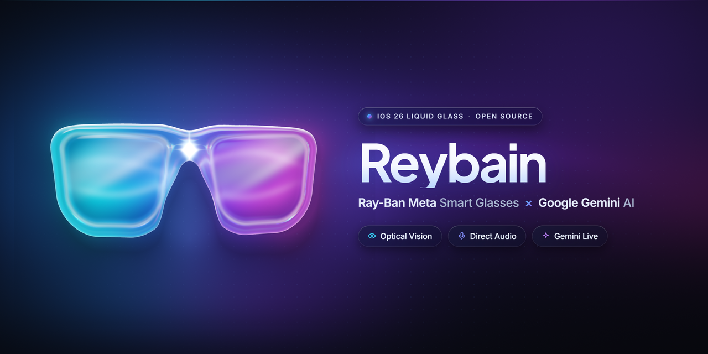
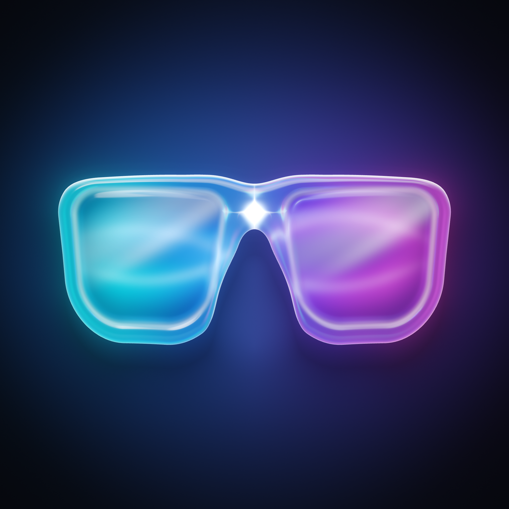
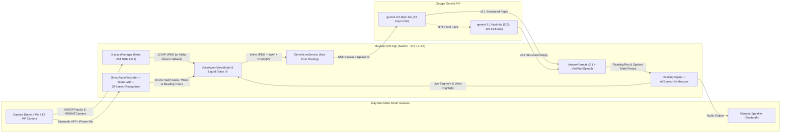

<div align="center">



<br />
<br />



# Reybain

**iOS AI Assistant for Ray-Ban Meta Smart Glasses — powered by Google Gemini, Direct Multimodal Audio & iOS 26 Liquid Glass**

[](https://developer.apple.com/ios/)
[](https://swift.org/)
[](https://github.com/facebook/meta-wearables-dat-ios)
[](https://ai.google.dev/)
[](LICENSE)

[Key Features](#key-features) • [Workflows & Controls](#hardware-workflows--voice-controls) • [Architecture](#architecture) • [Getting Started](#getting-started) • [Testing & CI](#testing--ci) • [Privacy & Security](#privacy--security)

</div>

---

> [!NOTE]
> **Tóm tắt tiếng Việt:** **Reybain** là trợ lý AI mã nguồn mở trên iOS dành riêng cho kính **Ray-Ban Meta**, kết hợp **Google Gemini 3.5 / 3.1 Flash-Lite**, **gửi âm thanh trực tiếp (Direct Multimodal Audio)**, bộ đọc công thức toán tự nhiên tiếng Việt (**VietMathSpeech**) và giao diện **iOS 26 Liquid Glass**. Bấm 1 lần nút trên kính để chụp ảnh 12 MP và giải bài tập tức thì (**Chế độ Giải bài**) hoặc chụp & hỏi rảnh tay song ngữ Việt–Anh (**Chế độ Bình thường**); bấm 2 lần để nghe lại đáp án qua loa kính đồng bộ trực tiếp với màn hình iPhone.

---

## Key Features

### Two Tailored Hardware Workflows (`UsageMode`)
- **Study Mode (`Giải bài tập`)** — Single-press the Ray-Ban Meta capture button to snap a full-resolution **12 MP** photo directly through the Meta Wearables DAT SDK (`MWDATInputs` + `MWDATCamera`) and immediately send a configurable short solve prompt (e.g., *"Giải bài trong ảnh này."*). Structured multiple-choice and step-by-step essay solutions stream straight to the glasses speaker without waiting for Meta AI Camera Roll import.
- **General Mode (`Sử dụng bình thường`)** — Single-press to capture a photo and open hands-free listening for everyday queries: scenery, street signs, menus, translations, objects, or open-ended questions.
- **Double-Press Replay with Live UI Sync** — Double-pressing the capture button replays the last answer from the start through `ReadingEngine`, highlighting the active segment and spoken word live on the iPhone screen. Per-gesture overrides (short press, hold, double press) are fully customizable in **Settings → Glasses**.
- **A2DP Stereo Music Coexistence** — With `pauseWakeWordDuringMusic` enabled, Reybain avoids holding the Bluetooth HFP mic channel open while idle during music playback, preventing HFP chimes and preserving stereo A2DP audio quality on Ray-Ban Meta.

### Direct Multimodal Audio to Gemini
- **Raw 16 kHz WAV Inline Audio** — Captures crisp 16 kHz mono PCM WAV audio (`DirectAudioRecorder`) and sends it straight to Gemini (`inlineData: audio/wav`) alongside optional 12 MP JPEG photo context:
  - **Hands-Free General Mode** — Acoustic end-of-speech detection via on-device CoreML **Silero VAD** (`FluidAudio`) automatically commits your spoken turn and transmits raw audio directly to Gemini.
  - **Chat Voice Note Recorder** — Tap the mic button inside the floating composer pill to record a voice note with a real-time animated `AudioWaveformMeter`, explicit Cancel/Send controls, and seamless photo attachment.
- **Effortless Mixed Vietnamese–English Understanding** — Gemini natively understands bilingual code-switching, technical terms, and natural phrasing while auto-correcting speech recognition errors—without bloating multi-turn `conversationHistory` with stored base64 audio payloads.
- **Zero-Latency Local Wake Word & Playback Controls** — Lightweight on-device `SFSpeechRecognizer` stays dedicated to wake-word detection (**`"Ok Vision"`** / **`"Ok Reybain"`**) and instant local voice playback commands so pause, resume, and jump never wait on the network.

### iOS 26 Liquid Glass & Apple Intelligence UI
- **Calibrated OLED Obsidian Design System** — Anchored on deep midnight obsidian (`#05060A`) with elevated editorial content cards (`#0E121D` / `#141928`), concentric squircle corners, and directional `0.75 pt` specular rim hairlines for WCAG AA/AAA readability.
- **Cross-Version iOS 17–26 Liquid Glass** — Uses native iOS 26 `.glassEffect` & `GlassEffectContainer` (strictly guarded with `#if compiler(>=6.2)` and `#available(iOS 26.0, *)`) alongside faithful `.ultraThinMaterial` specular fallbacks on iOS 17–25, with full `Reduce Transparency` and `Reduce Motion` accessibility support.
- **Apple Intelligence Optical Motion** — Four-hue iridescent spectrum (**Cyan → Electric Indigo → Violet → Magenta**) illuminates active states across the prism `SwirlOrb`, `AppleIntelligenceGlow` border halo, `LiveActivityCard`, floating `LiquidGlassFloatingTabBar`, floating `PlaybackBar`, and 4-state morphing pill composer (`Idle` → `Typing` → `Recording` → `Sending`).

### Resilient Key-First Gemini Routing
- **Key-First Rotation, Then Model Fallback** — When multiple Gemini API keys are configured (comma-separated in **Settings → Gemini**), `GeminiLiveService` exhausts every healthy key on **`gemini-3.5-flash-lite`** before falling back to **`gemini-3.1-flash-lite`** on HTTP `503` (overloaded) or `429` (rate-limited/quota), tracking per-(model, key) cooldowns and classifying exact failure causes (`GeminiFailureKind`).
- **Real-Time Progress & Spoken Status Cues** — `UploadProgressDelegate` streams live upload percentages (`0–100%`) to the `LiveActivityCard` while optional spoken status announcements (`spokenStatusUpdates`) keep you informed hands-free through the glasses speaker (capturing, uploading, rotating keys/models, ready).
- **Agentic Capture & Smart Multi-Turn Context** — Automatically captures a photo if Gemini requests visual context, retains up to 3 recent user/model exchanges (`maxHistoryEntries = 6`), and deduplicates unchanged photos by content fingerprint so follow-up questions upload zero redundant image bytes.

### Vietnamese Math Speech Engine (`VietMathSpeech`) & Dictation Mode (`Đọc chép`)
- **Classroom-Natural Spoken Math** — A pure-Swift lexer/parser pipeline (`MathLexer` → `MathParser` → `VietnameseMathReader` / `EnglishMathReader`) converts LaTeX expressions into natural Vietnamese or English speech (e.g., *"x bình phương cộng hai ích trên ba"*), strictly sanitizing forbidden raw syntax (`\`, `$`, `{`, `}`, `^`, `_`) before `AVSpeechSynthesizer`, while `MathPrettyText` renders crisp native inline Unicode formulas in SwiftUI without heavy WebViews.
- **Granular Reading & Dictation Controls** — Independent reading speeds for MCQ, Essay, and plain answers; adjustable math slowdown factor and pauses between answers, lines, and formulas; customizable math reading style (*`"trên"` vs `"phần"`*, *`"âm"` vs `"trừ"`*, Vietnamese letter names, custom pronunciation dictionary, and built-in **Math Speech Tester**).
- **Dictation Mode (`Đọc chép`) & Offline History Replay** — Pauses after each essay line waiting for `"tiếp"` (or an optional auto-continue timer up to 30 s, with optional double formula repetition). Saved conversations persist structured `ReadingRecord` plans for instant **offline History replay**.

---

## Hardware Workflows & Voice Controls

### Glasses Capture Button (Default Presets)

| Gesture | Study Mode (`Giải bài tập`) | General Mode (`Sử dụng bình thường`) |
| :--- | :--- | :--- |
| **Single Press** | Capture 12 MP photo & solve immediately with Study prompt | Capture 12 MP photo & open hands-free direct audio mic |
| **Double Press** | Replay last answer from the beginning (synced with UI) | Replay last answer from the beginning (synced with UI) |
| **Press & Hold** | Capture photo & open mic for a custom question | Capture photo & run quick solve prompt |

> *Per-gesture mapping can be customized independently in **Settings → Glasses (`Kính Ray-Ban Meta`)**.*

### Local Voice Playback Commands (Bilingual)

Handled instantly on-device via `ReadingCommand` without consuming Gemini API quota:

| Action | Vietnamese Examples | English Examples |
| :--- | :--- | :--- |
| **Pause / Resume** | `"tạm dừng"`, `"chờ chút"` / `"tiếp"`, `"tiếp tục"` | `"pause"`, `"wait"` / `"resume"`, `"continue"` |
| **Next / Previous** | `"dòng tiếp"`, `"câu sau"` / `"dòng trước"`, `"quay lại"` | `"next"`, `"next line"` / `"previous"`, `"back"` |
| **Jump to Item** | `"đọc lại câu 3"`, `"dòng 5"`, `"bài 2"` | `"question 3"`, `"line 5"` |
| **Repeat / Restart** | `"đọc lại"`, `"nhắc lại"` / `"đọc lại từ đầu"` | `"repeat"`, `"again"` / `"start over"`, `"restart"` |
| **Speed / Stop** | `"chậm lại"`, `"nhanh lên"` / `"dừng lại"`, `"thôi"` | `"slower"`, `"faster"` / `"stop"` |

---

## Architecture



### Project Layout

```text
Reybain/
├── App/                  # ReybainApp entry point & Meta DAT bootstrap
├── Config/               # Constants & gitignored Config.swift (.example tracked)
├── Managers/             # GlassesManager, SettingsManager, SettingsSecrets (Keychain), ConversationManager
├── Models/               # AppSettings, UsageMode, Conversation
├── Services/
│   ├── Audio/            # AudioSessionManager (off-main-thread XPC, A2DP/HFP), SoundService
│   ├── GeminiLive/       # GeminiLiveService (SSE streaming, key-first routing, upload progress)
│   ├── Glasses/          # GlassesButtonRouter, GlassesConnectionCoordinator
│   ├── Speech/           # VietMathSpeech, MathLexer/Parser, MathPrettyText, AnswerFormat v2.1, PromptV2, ReadingMachine, ReadingCommand
│   ├── TTS/              # ReadingEngine, TTSService
│   ├── Voice/            # DirectAudioRecorder, VoiceCommandService, SpeechActivityDetector (FluidAudio Silero VAD)
│   └── Telemetry/        # TurnTimeline, MetricsCollector
├── Utilities/            # AppLog (OSLog + ring buffer + Documents/reybain.log), HapticFeedback
├── Views/
│   ├── Components/       # Theme, LiquidGlass, AudioWaveformMeter, SwirlOrb, SegmentCardView, PlaybackBar, OnboardingView
│   ├── VoiceAgent/       # VoiceAgentView (Live tab) & VoiceAgentViewModel
│   ├── History/          # ConversationListView & ConversationDetailView (offline replay)
│   └── Settings/         # WorkflowMode, Glasses, Gemini, Voice, Reading, MathSpeech, Memories, Debug
└── Resources/            # Info.plist, Assets.xcassets (AppIcon)
ReybainTests/             # Unit & Blueprint E2E suites (VietMath, AnswerFormat, DirectAudio, Gemini, PhotoLibrary)
```

---

## Getting Started

### Prerequisites

- **Hardware:** iPhone running **iOS 18+** (UI compiles safely across iOS 17–26) and **Ray-Ban Meta Smart Glasses**.
- **Meta AI App:** **Developer Mode** enabled in the Meta AI companion app (required for experimental Meta DAT SDK `1.0.1` capture-button routing and direct full-resolution photo capture).
- **Google Gemini API Key(s):** Free or paid key(s) from [Google AI Studio](https://aistudio.google.com/app/apikey). Multiple keys from separate projects can be entered comma-separated in-app for automatic rotation.
- **For Local Builds:** macOS with **Xcode 16+ / Xcode 26+** (GitHub Actions builds with **Xcode 26.6** on `macos-26`).

### Option 1 — Build an Unsigned IPA with GitHub Actions

No Mac required to produce a sideloadable IPA:

1. Fork or clone this repository on GitHub.
2. Open the **Actions** tab → select **Build Unsigned IPA** ([`.github/workflows/build-ipa.yml`](.github/workflows/build-ipa.yml)) → click **Run workflow**.
3. The workflow runs static blueprint & Xcode project checks, compiles `Reybain.app` in `Release` configuration, verifies required binary symbols (`scripts/blueprint/verify_ipa_symbols.sh`), and uploads the **`Reybain-unsigned`** artifact containing **`Reybain.ipa`**.
4. Sideload `Reybain.ipa` onto your iPhone using AltStore, SideStore, or Sideloadly.

### Option 2 — Build Locally in Xcode

```bash
git clone https://github.com/darwnlinz1/Visor-iOS-Solver.git
cd Visor-iOS-Solver

# Create local gitignored configuration files from the templates
cp Config.xcconfig.example Config.xcconfig
cp Reybain/Config/Config.swift.example Reybain/Config/Config.swift

# Open in Xcode
open Reybain.xcodeproj
```

Edit **`Config.xcconfig`** with your local signing & Meta Developer values (never commit this file):

```xcconfig
DEVELOPMENT_TEAM = YOUR_TEAM_ID
PRODUCT_BUNDLE_IDENTIFIER = com.reybain.app
META_APP_ID = YOUR_META_APP_ID
CLIENT_TOKEN = AR|YOUR_META_APP_ID|YOUR_CLIENT_TOKEN
APP_LINK_URL_SCHEME = reybain
```

> [!TIP]
> In Meta AI **Developer Mode**, `META_APP_ID` can be set to `0` for local testing. Leave `defaultGeminiAPIKey = ""` in `Reybain/Config/Config.swift` and paste your API key(s) inside the app so they are stored securely in the iOS Keychain. If you modify `project.yml`, you can regenerate the Xcode project with `make generate` (requires `xcodegen`).

### First-Run Configuration

1. **Register Glasses:** Open **Settings → Kính Ray-Ban Meta → Đăng ký app** to authorize Reybain via the Meta AI app.
2. **Add Gemini Key(s):** Open **Settings → Gemini** and paste one or more Gemini API keys (comma-separated).
3. **Choose Mode & Voice:** Pick **Study Mode** or **General Mode** in **Settings → Chế độ hoạt động**, toggle **Direct Audio to Gemini** (`Gửi thẳng âm thanh lên Gemini`), and download an **Enhanced / Premium Vietnamese voice** in iOS *Settings → Accessibility → Spoken Content → Voices* for the clearest spoken math.
4. **Test Capture:** Press the capture button on your Ray-Ban Meta glasses (or tap **Chụp thử** in Glasses Settings) to verify the button link and 12 MP photo pipeline.

### On-Device Diagnostics & Persistent Logs

`AppLog` mirrors structured logs across three targets simultaneously:
- Apple Unified Logging (`OSLog`, subsystem `com.reybain.app`)
- An in-memory 2,000-line ring buffer searchable in **Settings → Debug**
- Persistent rotating log files on-device at **`Documents/reybain.log`** (auto-rotates to `Documents/reybain.prev.log` at 512 KB)

You can export diagnostic reports (`Reybain-logs.txt`) directly from **Settings → Debug**, including optional Meta Wearables SDK `OSLogStore` entries from the last 10 minutes.

---

## Testing & CI

Reybain ships with multi-layer automated verification covering static safety invariants, pure-Swift math/speech suites, and full iOS Simulator E2E tests:

```bash
# Static architecture, security, and secret-leak guard (seconds, any OS)
python3 scripts/blueprint/verify_blueprint.py

# Xcode project.pbxproj sync tool self-test (any OS)
python3 scripts/pbxproj_files.py --self-test

# Pure-Swift speech, math, reading, and prompt suites via SwiftPM (no Xcode needed)
scripts/swift-local/run.sh

# Full XCTest + Blueprint E2E suites on an iOS 18+ Simulator (macOS + Xcode)
make e2e
make e2e-blueprint

# Verify binary symbols in a packaged unsigned IPA
make verify-ipa IPA=Reybain.ipa
```

Every pull request automatically runs **CI** ([`.github/workflows/ci.yml`](.github/workflows/ci.yml) — static checks, pure-Swift tests, and device build-for-testing) and **E2E (Blueprint)** ([`.github/workflows/e2e.yml`](.github/workflows/e2e.yml) — static guard plus full Simulator E2E suites using scripted Gemini endpoints and the real Simulator Photos library).

---

## Privacy & Security

- **Keychain-Only Secret Storage:** Gemini API keys are stored exclusively in the iOS Keychain (`com.reybain.secrets`, with automatic migration fallback from legacy OpenVision Keychain items) via `SettingsSecrets` and are stripped from `Documents/settings.json`. Keys are sent only in the `x-goog-api-key` HTTP header and never written to logs.
- **Zero Keys in Source Control:** `Config.xcconfig` and `Reybain/Config/Config.swift` are gitignored, and `scripts/blueprint/verify_blueprint.py` fails CI immediately if any key-like token appears in any tracked file.
- **Meta-Album-Only Photo Fallback:** If direct Meta DAT photo capture is unavailable and Reybain falls back to the Photos library, `RecentPhotoScanner` strictly filters for **Meta / Ray-Ban / Stories** albums within the recent capture window. Private iPhone Camera Roll photos outside those albums are never read or uploaded (enforced by `BlueprintPhotoLibraryE2ETests`).
- **On-Device Speech & Logging Hygiene:** Wake-word recognition (`SFSpeechRecognizer`) and Silero VAD (`FluidAudio`) run locally on-device. Sensitive speech/text transcripts are suppressed from persistent logs unless `verboseLogging` is explicitly enabled in Debug settings.

For vulnerability reporting, see [SECURITY.md](SECURITY.md).

---

## License & Acknowledgments

Released under the **MIT License** — see [LICENSE](LICENSE) for full terms. Contributions are welcome; see [CONTRIBUTING.md](CONTRIBUTING.md) and [PLAN.md](PLAN.md).

Built with and inspired by:
- [Meta Wearables DAT SDK](https://github.com/facebook/meta-wearables-dat-ios) — Ray-Ban Meta hardware integration (`MWDATCore`, `MWDATCamera`, `MWDATInputs`)
- [Google Gemini API](https://ai.google.dev) — Multimodal vision + direct audio intelligence
- [FluidAudio](https://github.com/FluidInference/FluidAudio) — CoreML Silero VAD for acoustic end-of-speech detection
- [rayl15/OpenVision](https://github.com/rayl15/OpenVision) — Original upstream foundation
- [Visor](https://github.com/macedonga/visor) — Smart-glasses workflow inspiration
