# BÁO CÁO NGHIÊN CỨU SO SÁNH CHUYÊN SÂU (RESEARCH COMPARISON)
## VISOR VS OPENVIEW VS OPENVISION VS META WEARABLES DAT 1.0

*Mã tài liệu:* `RESEARCH_COMPARISON.md`  
*Ngày thực hiện:* 07/11/2026  
*Phạm vi:* Kiến trúc phần cứng Ray-Ban Meta Gen 2, Giao thức kết nối, Meta DAT SDK, AI Engine và Khả năng triển khai thực tế.

---

## 1. PHÂN TÍCH CHI TIẾT 3 GIẢI PHÁP & CÔNG NGHỆ

```mermaid
graph TD
    subgraph Solution1 [1. Visor Android]
        V_HW[Ray-Ban Meta Gen 2] -->|BLE DataX / Thrift| V_App[Visor Android App]
        V_App -->|Wi-Fi Direct| V_Airship[Airship Media Stream]
        V_App -->|HTTP REST| V_Bridge[PC Bridge Server]
        V_Bridge -->|REST v1beta| V_Gemini[Google Gemini API]
    end

    subgraph Solution2 [2. OpenVision iOS]
        O_HW[Ray-Ban Meta Gen 2] -->|Meta DAT SDK| O_App[OpenVision iOS App]
        O_App -->|WebSocket wss://| O_Live[Gemini Live Exp - HTTP 404]
        O_App -->|On-Device MLX| O_Local[Local Gemma / SmolVLM]
        O_App -->|On-Device Kokoro| O_TTS[Local Neural TTS]
    end

    subgraph Solution3 [3. Clean iOS Math Solver - Đề xuất]
        M_HW[Ray-Ban Meta Gen 2] -->|Meta DAT 0.9.0 / 1.0| M_App[Minimalist iOS Solver]
        M_App -->|On-Demand Hi-Res Capture| M_Engine[Image Engine 2048px]
        M_Engine -->|HTTPS REST + Thinking| M_Pool[Gemini Key Pool + Circuit Breaker]
        M_Pool -->|Primary 500 RPD| M_G35[Gemini 3.5 Flash Lite]
        M_Pool -->|Secondary Fallback| M_OR[OpenRouter API]
        M_G35 -->|Dual-Channel Parse| M_Audio[AVAudioSession -> Temple Speakers]
    end
```

---

## 2. BẢNG SO SÁNH MA TRẬN KỸ THUẬT TOÀN DIỆN (14 TIÊU CHÍ)

| Tiêu chí kỹ thuật | VISOR (Android) | OPENVISION (iOS) | META WEARABLES DAT 1.0 | CLEAN IOS MATH SOLVER (Kiến trúc chuẩn) |
|---|---|---|---|---|
| **Nền tảng hỗ trợ** | Android 10+ | iOS 18.0+ | iOS 17.2+ & Android | iOS 18.0+ (Tối ưu iPhone 15 Pro) |
| **Giao thức phần cứng** | BLE DataX đảo ngược (Reverse Engineered) | Meta DAT SDK 0.9.0 (`MWDATCore`, `MWDATCamera`) | SPM Framework chính thức từ Meta | Meta DAT SDK 0.9.0 (`MWDATCore`, `MWDATCamera`) |
| **Kênh điều khiển** | Service 15 (`m0`), Thrift NetEvents | `Wearables.shared`, `DeviceSession` | `Wearables.shared`, `DeviceSession` | `Wearables.shared`, `DeviceSession` |
| **Vòng đời Session** | Thủ công qua `LinkState.READY` & keepalive | `session.start()` -> `.started` -> `addCamera()` | Bắt buộc session `.started` trước khi gắn Camera | State machine bất đồng bộ với timeout 15s |
| **Phương thức thu ảnh** | Chụp shutter Event 73 -> Kéo qua Wi-Fi Direct Service 53 | Camera stream -> `stream.capturePhoto(format: .jpeg)` | Camera stream -> `capturePhoto()` hoặc frame callback | Khởi động camera -> Chụp 1 ảnh tĩnh native JPEG -> Ngắt camera |
| **Độ phân giải & Chất lượng ảnh** | 3024x4032 (Gốc từ kính, 1–2 MB) | Bị ép về 512px, JPEG 50% (Rất mờ) | Native camera sensor JPEG (lên tới 3024x4032) | Giữ nguyên gốc 2048–3024px, JPEG 85–90% |
| **Phát hiện mờ & Orientation** | Không có | Không có | Phụ thuộc App layer xử lý | Phân tích phương sai Laplacian + Auto EXIF orientation |
| **Cơ chế âm thanh phản hồi** | Thrift NetEvent 57/392 (Loa kính) + Phone TTS fallback | `AVAudioSession` (.allowBluetoothA2DP) -> Loa kính | Hỗ trợ microphone stream + CoreAudio system audio | `AVAudioSession` + `AVSpeechSynthesizer` trực tiếp lên loa kính |
| **Tích hợp Gemini** | Qua Bridge PC (`antigravity_bridge.py`) | WebSocket Gemini Live (`gemini-2.0-flash-exp`) | Không có sẵn (Nhà phát triển tự tích hợp) | Native HTTPS REST v1beta (`gemini-3.5-flash-lite`, 500 RPD) |
| **Hỗ trợ API Key Pool** | File python trung gian trên PC | Chỉ 1 key đơn lẻ trong `Config.swift` | N/A | Key Pool nội bộ trên iPhone, xoay vòng, circuit breaker |
| **Dự phòng OpenRouter** | Không có | Không có | N/A | Fallback tự động khi Google API gặp sự cố |
| **Kích thước gói cài đặt** | ~71 MB (APK) | 49.6 MB (IPA do dính MLX, Kokoro) | Frameworks ~ 8 MB | **< 8 MB (IPA siêu nhẹ, thuần Swift)** |
| **Khả năng chạy trên iPhone 15 Pro** | **0% (Không thể cài APK)** | **100% (Đã build được IPA)** | **100% (Native Swift SDK)** | **100% (Cài đặt trực tiếp qua pymobiledevice3)** |
| **Giấy phép phần mềm** | AGPL-3.0 | MIT (rayl15) | Meta Wearables SDK License | Dự án nội bộ (Tuân thủ DAT Developer Terms) |

---

## 3. NGHIÊN CỨU CHI TIẾT TỪNG PHƯƠNG ÁN

### 3.1 Phương án A: Visor (`macedonga/visor`)
- **Điểm mạnh:**
  - Khám phá cực kỳ sâu về giao thức phần cứng nội bộ của Meta Ray-Ban (DataX, Thrift IDs, Service 15/33/53).
  - Can thiệp được watchdog timeout qua MobileConfig (`assistant_on_sn.default_processing_timeout_s = 300L`), tránh bị ngắt sau 20s.
  - Chụp ảnh full resolution 3024x4032 trực tiếp từ sensor mà không qua stream video.
- **Điểm yếu chí mạng:**
  - Viết 100% bằng Kotlin cho Android SDK. Không có khả năng biên dịch sang iOS.
  - Giao thức đảo ngược (unsupported reverse-engineering) dễ bị Meta vô hiệu hóa sau các bản cập nhật firmware của kính.
  - Phụ thuộc vào bridge server bên ngoài để giao tiếp với AI.

### 3.2 Phương án B: OpenVision (`rayl15/OpenVision` / `darwnlinz1/OpenVision`)
- **Điểm mạnh:**
  - Viết hoàn toàn bằng Swift và SwiftUI, tương thích tối đa với iOS 18.
  - Sử dụng SDK chính thức của Meta (`meta-wearables-dat-ios` v0.9.0).
  - Đã có sẵn quy trình build CI/CD trên GitHub Actions (`macos-26`) và tải IPA về máy host.
  - Đã xác thực cơ chế chuyển hướng âm thanh Bluetooth A2DP vào loa kính qua `AudioSessionManager`.
- **Điểm yếu nghiêm trọng:**
  - Tích hợp Gemini sai kiến trúc: Dùng WebSocket streaming liên tục thay vì REST API chụp ảnh tĩnh bài tập.
  - Model cấu hình mặc định đã bị ngừng hoạt động (`gemini-2.0-flash-exp` -> HTTP 404).
  - Thu nhỏ ảnh xuống 512px làm mất nét công thức toán.
  - Kích thước cồng kềnh (gần 50 MB) do nhúng cả engine suy luận cục bộ MLX và mô hình trọng số on-device.

### 3.3 Phương án C: Meta Wearables Device Access Toolkit (DAT 1.0 / 0.9.0)
- **Đặc tả chính thức:**
  - Phân phối qua Swift Package Manager: `https://github.com/facebook/meta-wearables-dat-ios`, phiên bản ổn định được pin cứng là `0.9.0`.
  - Cung cấp 2 module cốt lõi:
    - `MWDATCore`: Quản lý thực thể `Wearables.shared`, quyền truy cập thiết bị, đăng ký ứng dụng (`startRegistration`), luồng trạng thái (`registrationStateStream`).
    - `MWDATCamera`: Quản lý camera Ray-Ban Meta. Bao gồm cấu hình stream `StreamConfiguration(videoCodec:resolution:frameRate:)`, phiên làm việc `DeviceSession`, và hàm chụp ảnh tĩnh `stream.capturePhoto(format: .jpeg)`.
- **Vòng đời Session bắt buộc (Invariants):**
  1. Ứng dụng phải được cấp quyền Camera thông qua Meta View companion app: `wearables.checkPermissionStatus(.camera)` -> `wearables.requestPermission(.camera)`.
  2. Bắt buộc phải gọi `session.start()` và chờ trạng thái `stateStream` phát tín hiệu `.started` trước khi gọi `session.addCamera()`. Nếu gắn camera vào session đang ở trạng thái idle, SDK sẽ trả về `nil` và ném lỗi timeout.
  3. Khi ứng dụng chuyển sang Background, video codec thô sẽ tạm dừng theo thiết kế bảo mật của iOS/Meta. Do đó, tác vụ chụp ảnh phải được kích hoạt và hoàn tất khi ứng dụng ở Foreground hoặc thông qua Background Task có audio session hoạt động.
- **Chính sách phân phối & Developer Mode:**
  - Kính Ray-Ban Meta Gen 2 phải được kích hoạt **Developer Mode** bên trong ứng dụng Meta View.
  - Yêu cầu cấu hình Meta App ID (`306760944872162`) và Client Token (`AR|<META_APP_ID>|<CLIENT_TOKEN>`).
  - Gói ứng dụng triển khai cho mục đích cá nhân/nghiên cứu thông qua hình thức Sideloading (Ad-Hoc / Unsigned IPA cài đặt trực tiếp qua `pymobiledevice3`).

---

## 4. KẾT LUẬN NGHIÊN CỨU

1. **Khẳng định về nền tảng:** Vì thiết bị đích của người dùng là **iPhone 15 Pro (iOS 18/26)**, giải pháp Visor (Android) chỉ có giá trị tham khảo về giao thức và tư duy xử lý prompt kênh đôi (Dual-Channel), không thể làm phần mềm chạy trên máy.
2. **Khẳng định về SDK:** Meta Wearables Device Access Toolkit 0.9.0 là nền tảng vững chắc, chính quy và ổn định nhất để điều khiển phần cứng kính Ray-Ban Meta Gen 2 trên iOS.
3. **Định hướng tối ưu:** Tận dụng bộ khung kết nối phần cứng của OpenVision (`GlassesManager.swift`), **lược bỏ toàn bộ rác mã nguồn (MLX, On-device models, WebSocket video)**, nâng cấp độ phân giải camera lên chuẩn sắc nét, và thay thế toàn bộ tầng AI bằng **Gemini REST Engine chuyên dụng giải bài tập**.
