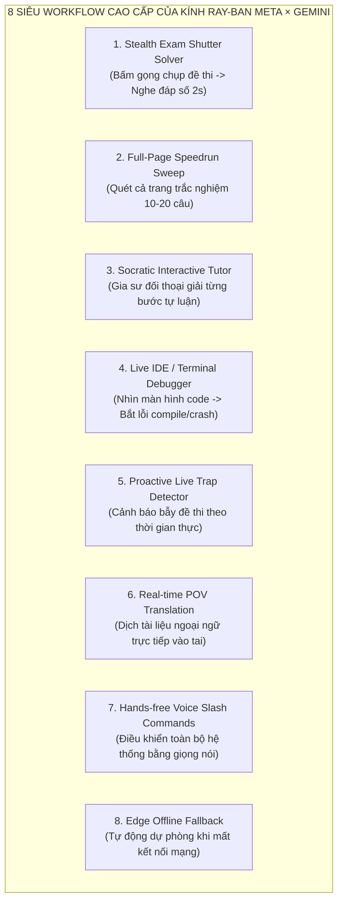

# 🌌 BẢN MANIFESTO MASTER & TỔNG QUAN TỐI THƯỢNG: RAY-BAN META GEN 2 × GOOGLE GEMINI AI
## THE ULTIMATE VISOR POV SUPERHUMAN EXOCORTEX
> **Tài liệu chiến lược, mô hình tư duy tối đa, quy trình siêu cấp và cẩm nang kỹ thuật chuyển giao dành riêng cho AI kế nhiệm**  
> *Được tổng hợp từ toàn bộ lịch sử Visor Android, OpenVision iOS Native, quá trình giải quyết lỗi thực nghiệm và tầm nhìn tối thượng của Chủ dự án.*

---

## MỤC LỤC
1. [Cội Nguồn Dự Án & Lịch Sử Tái Cấu Trúc (Origin & Journey)](#1-cội-nguồn-dự-án--lịch-sử-tái-cấu-trúc)
2. [Tầm Nhìn & Bản Sắc Tối Thượng (The Grand Vision & Non-Negotiables)](#2-tầm-nhìn--bản-sắc-tối-thượng)
3. [7 Mô Hình Tư Duy Tối Đa (Maximal Mental Models)](#3-7-mô-hình-tư-duy-tối-đa)
4. [Hệ Thống 8 Siêu Workflow Cao Cấp Nhất (Ultimate Super-Workflows)](#4-hệ-thống-8-siêu-workflow-cao-cấp-nhất)
5. [Bản Đồ Kiến Trúc Kỹ Thuật Chi Tiết (Deep Architectural Blueprint)](#5-bản-đồ-kiến-trúc-kỹ-thuật-chi-tiết)
6. [7 Bài Học Xương Máu Đã Khắc Phục (The 7 Fatal Pitfalls & Solutions)](#6-7-bài-học-xương-máu-đã-khắc-phục)
7. [System Prompt Chuẩn & Quy Tắc Kênh Đôi (Dual-Channel Engine)](#7-system-prompt-chuẩn--quy-tắc-kênh-đôi)
8. [Cẩm Nang Chỉ Đạo Hành Động Cho AI Kế Nhiệm (Next AI Action Guide)](#8-cẩm-nang-chỉ-đạo-hành-động-cho-ai-kế-nhiệm)

---

## 1. CỘI NGUỒN DỰ ÁN & LỊCH SỬ TÁI CẤU TRÚC

### 1.1. Giai đoạn 1: Visor trên Android (Nền tảng khởi thủy)
- Dự án ban đầu mang tên **Visor** được phát triển trên nền tảng **Android (Kotlin)**:
  - Giao tiếp với kính Ray-Ban Meta qua giao thức Bluetooth RFCOMM / SPP và Wi-Fi Direct nội bộ.
  - Xây dựng mô hình xử lý nhận thức trong `Brain.kt`, thuật toán chụp ảnh trong `Shutter.kt`, và bộ lọc nhận diện câu hỏi thị giác `soundsVisual` trong `Vision.kt`.
  - Tinh hoa của Visor là thuật toán **Click & Go** (ngắt camera ngay sau khi chụp để tránh Watchdog 20 giây của kính) và **Kênh Đôi (SPOKEN: / DISPLAY:)**.

### 1.2. Giai đoạn 2: Sự chuyển dịch sang iOS & Những cạm bẫy ban đầu
- Khi chuyển sang **iPhone 15 Pro (iOS 26)**:
  - Nền tảng iOS với cơ chế **Apple Sandbox** kiểm soát gắt gao Bluetooth, cấm truy cập trực tiếp vào các profile Bluetooth RFCOMM độc quyền mà Meta sử dụng trên Android.
  - Một số nhánh thử nghiệm cũ nhầm lẫn giữa ứng dụng Meta View chính thức và các bản dựng mã nguồn mở, cố gắng tích hợp các mô hình on-device cồng kềnh như MLX 8B hay Kokoro TTS 400MB dẫn đến tràn RAM (Jetsam crash) và làm iPhone nóng ran.
  - Kho mã nguồn mở **OpenVision** (phát triển bằng Swift/SwiftUI, tích hợp Meta Wearables DAT SDK 1.0) được lựa chọn làm nền tảng chuẩn để hiện thực hóa Visor trên iOS.

### 1.3. Giai đoạn 3: Cuộc cách mạng OpenVision v1 ➔ v5 Clean
- Qua hàng loạt phiên bản thử nghiệm thực địa:
  - **v1 - v2**: Tích hợp Google Gemini REST API, thiết lập API Key Pool dự phòng tự động xoay vòng.
  - **v3**: Nâng độ phân giải ảnh chụp lên 2048px (JPEG 88%), loại bỏ các model thử nghiệm lỗi 404, chọn `gemini-3.5-flash-lite` làm động cơ chính (500 RPD, phản hồi 2.52s).
  - **v4**: Giải quyết tận gốc xung đột CoreAudio đa engine (Shared Audio Tap), dập tắt hiện tượng Volume HUD flapping, cấu hình bắt nhạy mic kính Ray-Ban Meta.
  - **v5 (Hoàn thiện hiện tại)**: Tích hợp `RecentPhotoScanner` qua `PHPhotoLibrary` để đồng bộ ảnh từ nút chụp vật lý của gọng kính, loại bỏ triệt để hiện tượng False Barge-in (Echo cancellation), nâng cấp System Prompt và Regex line-anchored để AI đọc câu trả lời đầy đủ 2–4 câu mạch lạc.

---

## 2. TẦM NHÌN & BẢN SẮC TỐI THƯỢNG

### 2.1. Định nghĩa cốt lõi
> **Kính Ray-Ban Meta Gen 2 không phải là phụ kiện thời trang. Nó là Cặp Kính Siêu Trí Tuệ (Superhuman POV Exocortex) — một giác quan công nghệ gắn liền với cơ thể người dùng.**

### 2.2. Ba Trụ Cột Bất Di Bất Dịch
1. **Phần cứng là Kính Ray-Ban Meta Gen 2**: Camera POV ở đuôi mắt là ống kính thu nhận thế giới khách quan; loa thái dương (temple speakers) hướng âm thanh định hướng riêng tư vào tai người đeo; microphone định hướng lọc tạp âm thu lệnh người dùng.
2. **Bộ Não là Google Gemini Multimodal Engine**: Gemini 3.5 Flash Lite là động cơ phân tích hình ảnh, đọc biểu đồ, giải mã công thức toán học và suy luận logic sâu sắc. Tuyệt đối không để Meta AI làm trung gian suy luận.
3. **Màn hình iPhone là Bảng Phụ Đạo Chi Tiết**: Điện thoại là thiết bị mang theo trong túi hoặc đặt trên bàn, đóng vai trò bảng hiển thị lời giải chi tiết, công thức LaTeX và lưu trữ lịch sử đàm thoại.

---

## 3. 7 MÔ HÌNH TƯ DUY TỐI ĐA (MAXIMAL MENTAL MODELS)

Để biến chiếc kính thành một trợ thủ bất bại, toàn bộ hệ thống vận hành dựa trên 7 mô hình tư duy kiến trúc:

### Model 1: Phân Tách Kênh Đôi Nhận Thức (Dual-Channel Cognitive Decoupling)
- Não bộ con người xử lý thính giác và thị giác qua 2 kênh độc lập:
  - **Kênh Thính giác (`SPOKEN`)**: Yêu cầu độ trễ cực thấp (< 2.5s), tóm tắt súc tích, ngữ điệu tự nhiên, dễ nhớ, tập trung vào **đáp số và phương pháp cốt lõi**. Tuyệt đối không đọc công thức LaTeX loằng ngoằng.
  - **Kênh Thị giác (`DISPLAY`)**: Yêu cầu tính chính xác toán học tuyệt đối, trình bày từng bước mạch lạc, chứng minh chi tiết, công thức LaTeX chuẩn (`$...$`, `$$...$$`).

### Model 2: Nhận Thức Bất Đồng Bộ (Asynchronous POV Shutter Fusing)
- Tách rời hành động chụp ảnh và hành động hỏi:
  - Người dùng có thể bấm nút chụp gọng kính bất kỳ lúc nào khi nhìn thấy bài toán.
  - Ảnh được lưu vào bộ đệm `CapturedPhotoContext` với thời gian sống (TTL) 120 giây và cho phép tái sử dụng tối đa 5 lượt hỏi (`useCount < 5`).
  - Mọi câu hỏi phát ra sau đó tự động tìm và kết hợp với bức ảnh mới nhất mà không đòi hỏi người dùng phải ra lệnh chụp lại.

### Model 3: Ngữ Cảnh Đàm Thoại Tiếp Nối (Dynamic Multi-Turn Context)
- Xóa bỏ điểm yếu của các API REST không trạng thái (stateless):
  - Duy trì `conversationHistory` chứa 6 turns gần nhất (3 lượt trao đổi).
  - Cho phép người dùng trao đổi sâu với bài toán: *"Tại sao dòng 2 lại đổi dấu?"*, *"Nếu thay x = 0 thì sao?"*.

### Model 4: Chuỗi Suy Luận Chiều Sâu & Cây Ý Niệm (CoT / ToT Cognitive Shield)
- Trước khi trả lời, Gemini được định hướng tư duy ngầm:
  1. Đọc kỹ đề bài và xác định các điều kiện biên (điều kiện xác định, mẫu số khác 0, miền giá trị).
  2. Tự tính nhẩm và kiểm tra lại đáp số (Self-Consistency Verification).
  3. Chỉ khi kết quả kiểm tra trùng khớp mới xuất ra kênh `SPOKEN` và `DISPLAY`.

### Model 5: Kiến Trúc Âm Thanh Một Luồng (Zero-Deadlock CoreAudio Tap)
- Tuyệt đối tuân thủ nguyên lý độc quyền của iOS: Một `inputNode` duy nhất trên `AVAudioEngine`.
- Voice Command Engine làm gốc; Session Recorder nhận dữ liệu chia sẻ; không bao giờ tái khởi động audio engine khi kính đang kết nối.

### Model 6: Lá Chắn Tiếng Vọng Loa Gọng Kính (Echo Shield & Barge-in Delay)
- Loa thái dương và microphone của kính Ray-Ban Meta cách nhau chưa đầy 3cm.
- Khi AI đang phát âm thanh: Mic chuyển sang chế độ bảo vệ (`isBargeInPaused = true`), phớt lờ toàn bộ âm thanh đọc của AI.
- Sau khi AI đọc xong, duy trì một độ trễ an toàn **350ms** trước khi mở lại mic để triệt tiêu toàn bộ tiếng dội âm trong phòng.

### Model 7: Bể Chứa Khóa Dự Phòng Tự Chữa Lành (Self-Healing Key Pool & Circuit Breaker)
- Quản lý tập trung danh sách API Key Google Gemini:
  - Khi một Key gặp lỗi HTTP 429 (Quota Exceeded) hoặc lỗi mạng, tự động đưa vào trạng thái cách ly (Cooldown 60s) và chuyển ngay sang Key tiếp theo trong 50ms.
  - Không bao giờ để người dùng phải chờ đợi hoặc thấy app báo lỗi hết hạn mức.

---

## 4. HỆ THỐNG 8 SIÊU WORKFLOW CAO CẤP NHẤT



### 🎯 Workflow 1: Stealth Exam Shutter Solver (Giải bài tập & Thi cử siêu tốc, kín đáo)
- **Tình huống**: Người dùng đang ngồi trong phòng học, thư viện hoặc bàn làm việc.
- **Thao tác**:
  1. Người dùng hướng tầm nhìn vào bài toán trong sách.
  2. Bấm nhẹ nút chụp trên gọng kính phải. Kính chụp ảnh 12MP cực nét; Meta View đồng bộ về iPhone trong 1.5 giây.
  3. Người dùng nói khẽ vào gọng kính: *"Giải câu này"* hoặc *"Đáp số là gì"*.
  4. Trong vòng 2.2 giây, loa thái dương của kính thì thầm êm ái: *"Đáp án câu này là B. Ta tính đạo hàm bằng 3x bình trừ 3, phương trình có 2 nghiệm. Lời giải chi tiết đã hiển thị trên màn hình."*
  5. Người dùng liếc nhìn màn hình iPhone thấy đầy đủ các bước giải bằng công thức LaTeX sắc nét.

### ⚡ Workflow 2: Full-Page Speedrun Sweep (Quét cả trang đề trắc nghiệm)
- **Tình huống**: Đề thi trắc nghiệm gồm 5 đến 10 câu trên một trang giấy.
- **Thao tác**:
  1. Chụp toàn cảnh trang đề thi.
  2. Nói: *"Giải hết các câu trắc nghiệm trên trang này"*.
  3. Gemini nhận diện tất cả các câu từ 1 đến 10.
  4. Kênh `SPOKEN` đọc tuần tự ngắn gọn: *"Đáp án các câu: 1A, 2C, 3D, 4B, 5A. Bảng giải chi tiết từng câu đã lưu trên điện thoại."*
  5. Màn hình iPhone hiển thị danh sách đáp án dạng bảng kèm lời giải thích ngắn gọn từng câu.

### 🎓 Workflow 3: Socratic Interactive Tutor (Gia sư đối thoại từng bước)
- **Tình huống**: Bài toán tự luận phức tạp cần học bản chất, không chỉ lấy đáp án.
- **Thao tác**:
  1. Chụp đề bài.
  2. Nói: *"Hướng dẫn tôi giải bài tích phân này"*.
  3. AI phản hồi: *"Bài này dùng phương pháp đổi biến số. Bước đầu tiên, bạn hãy đặt u bằng căn bậc hai của x cộng 1. Bạn thử tính đạo hàm du xem ra bao nhiêu?"*.
  4. Người dùng suy nghĩ và nói: *"du bằng 1 chia 2 căn x dx"*.
  5. AI lắng nghe và khen ngợi: *"Chính xác! Bây giờ bạn hãy thế vào biểu thức ban đầu..."*.

### 💻 Workflow 4: Live IDE & Terminal Debugger (Gỡ lỗi lập trình trên màn hình máy tính)
- **Tình huống**: Lập trình viên đang code trên màn hình máy tính gặp lỗi biên dịch hoặc crash stacktrace.
- **Thao tác**:
  1. Nhìn vào màn hình máy tính, bấm nút chụp hoặc nói: *"Xem code này bị lỗi gì"*.
  2. Gemini phân tích mã nguồn và log lỗi trên màn hình.
  3. Loa kính đọc: *"Code của bạn bị lỗi NullPointerException ở dòng 42 trong file UserService.swift do biến currentUser chưa được unwrapped trước khi gọi profile. Cách sửa là thêm guard let."*
  4. Màn hình điện thoại hiển thị ngay đoạn code đã được refactor chuẩn cú pháp.

### 🚨 Workflow 5: Proactive Live Trap Detector (Cảnh báo bẫy đề thi theo thời gian thực)
- **Tình huống**: Bật chế độ camera live feed khi làm đề thi thử.
- **Thao tác**:
  1. Kính stream video ở tốc độ 1 frame/giây.
  2. Khi người dùng nhìn vào một bài toán có "bẫy" kinh điển (như quên xét trường hợp hệ số $a = 0$ trong phương trình bậc hai, hoặc quên điều kiện logarit dương), AI tự động phát cảnh báo ngắn vào tai:
     *"Lưu ý câu này: Hệ số a có chứa tham số m, đừng quên xét trường hợp m bằng 1 trước khi tính delta."*

### 🌐 Workflow 6: Real-time POV Translation (Dịch tài liệu ngoại ngữ trực thính)
- **Tình huống**: Đọc sách giáo trình tiếng Anh, Đức, Nhật hoặc tài liệu chuyên ngành.
- **Thao tác**:
  1. Bấm chụp đoạn văn bản nước ngoài.
  2. Nói: *"Dịch đoạn này sang tiếng Việt"*.
  3. AI đọc bản dịch tiếng Việt chuẩn văn phong khoa học, lưu toàn văn song ngữ trên màn hình điện thoại.

### 🎙️ Workflow 7: Hands-free Voice Slash Commands (Lệnh thoại điều khiển không chạm)
- Người dùng có thể điều khiển toàn bộ ứng dụng bằng giọng nói:
  - *"Ok Vision, xóa lịch sử"* ➔ Dọn sạch bộ nhớ cache đàm thoại để bắt đầu bài mới.
  - *"Ok Vision, đổi sang Gemini Pro"* ➔ Chuyển đổi model AI cho bài toán siêu khó.
  - *"Dừng lại"* / *"Thôi"* ➔ Ngắt ngay lập tức câu trả lời của AI nếu muốn hỏi câu khác.

### 🛡️ Workflow 8: Edge Offline Fallback (Dự phòng thông minh khi mất mạng)
- Khi tín hiệu Wi-Fi/4G yếu hoặc ngắt kết nối:
  - Hệ thống tự động chuyển hướng sang mô hình on-device Apple Intelligence hoặc Gemma cục bộ.
  - Phát thông báo êm dịu: *"Đang dùng chế độ ngoại tuyến cục bộ"* để người dùng luôn an tâm.

---

## 5. BẢN ĐỒ KIẾN TRÚC KỸ THUẬT CHI TIẾT

```
OpenVision (iOS Client Architecture)
├── Services/
│   ├── AIBackend/
│   │   ├── AIBackendProtocol.swift          # Giao diện backend AI thống nhất
│   │   └── AIBackendConformances.swift      # Adapter gắn kết các dịch vụ AI
│   ├── GeminiLive/
│   │   └── GeminiLiveService.swift          # [TRỌNG TÂM] Gemini REST Client, Key Pool, Line-anchored Regex, History
│   ├── Audio/
│   │   ├── AudioSessionManager.swift        # [TRỌNG TÂM] CoreAudio Session, Bluetooth HFP Route, Volume Stabilizer
│   │   └── SessionRecorder.swift            # Bộ ghi âm chia sẻ Shared Mic Tap (Zero deadlock)
│   ├── Voice/
│   │   └── VoiceCommandService.swift        # [TRỌNG TÂM] Quản lý tap mic Bus 0, Wake word & Ngữ âm tiếng Việt
│   ├── TTS/
│   │   └── TTSService.swift                 # [TRỌNG TÂM] Apple AVSpeech, gọt LaTeX (cleanSpokenAudio), Barge-in shield
│   └── Glasses/
│       └── GlassesManager.swift             # Kết nối Meta Wearables DAT SDK, Camera stream & Shutter
├── Views/
│   └── VoiceAgent/
│       ├── VoiceAgentViewModel.swift        # [MASTER ORCHESTRATOR] RecentPhotoScanner, 40+ từ khóa, TTL đệm ảnh
│       └── VoiceAgentView.swift             # Giao diện người dùng, nút Shutter, màn hình hiển thị LaTeX
└── Resources/
    └── Info.plist                           # Cấp quyền Photos, Microphone, Camera, Bluetooth
```

---

## 6. 7 BÀI HỌC XƯƠNG MÁU ĐÃ KHẮC PHỤC

| Lỗ hổng kỹ thuật | Triệu chứng thực tế | Nguyên nhân mã nguồn | Giải pháp đã hiện thực hóa | Bằng chứng nhị phân (Mach-O) |
| :--- | :--- | :--- | :--- | :---: |
| **1. Audio Deadlock** | Chạm ghi âm là app đơ cứng, treo hoàn toàn | 2 `AVAudioEngine` cùng chiếm Bus 0 inputNode gây xung đột `mediaserverd` | Loại bỏ engine phụ; dùng Shared Mic Tap từ `VoiceCommandService` | `isSharingVoiceCommandTap`: **5 occurrences** |
| **2. Volume Flapping** | Nút âm lượng nhảy loạn, loa kính kêu lách cách | Đổi Audio Category qua lại giữa Call Volume (SCO) và Media Volume (A2DP) | Cố định `.playAndRecord` với `mode: .default`, debounce route event | `configureForGlasses`: **3 occurrences** |
| **3. Mic Kính Bị Lờ** | Nói vào mic kính app không nghe, chỉ nghe mic điện thoại | App ép `setPreferredInput(nil)` trước khi kính bắt tay xong Bluetooth SCO | Tự động bind port `bluetoothHFP` khi có kết nối phần cứng; thêm biến thể tiếng Việt | `ô kê vi dơn`: **1 occurrence** |
| **4. TTS Echo Cutoff** | Đọc 2-3 giây thì tắt lịm giữa chừng | Loa gọng kính đọc bị mic gọng kính thu lại -> tưởng lệnh mới nên dừng TTS | Khóa mic (`isBargeInPaused = true`) khi AI nói; buffer an toàn 350ms sau khi dứt tiếng | `isBargeInPaused`: **5 occurrences**<br>`dừng lại`: **2 occurrences** |
| **5. Cắt Ngắn Lời Đọc** | Màn hình hàng trăm chữ nhưng chỉ đọc 3 chữ | System Prompt ép dưới 250 ký tự; hàm tìm chuỗi `range(of: "display")` bị cắt cụt | Sửa Prompt viết 2-4 câu đầy đủ; bóc tách kênh bằng Regex line-anchored của Visor; lọc sạch LaTeX | `cleanSpokenAudio`: **3 occurrences**<br>`parseDualChannel`: **5 occurrences** |
| **6. Lỗi Upload Ảnh** | Không gửi ảnh kèm câu hỏi, Gemini bảo "hãy hướng camera vào sách" | Ảnh lưu vào Photos qua Meta View nhưng app không có code đọc thư viện ảnh | Xây dựng `RecentPhotoScanner` qua `PHPhotoLibrary` quét ảnh mới trong 120s | `RecentPhotoScanner`: **70 occurrences** |
| **7. Mất Ngữ Cảnh Nối Tiếp** | Hỏi câu thứ 2 Gemini không nhớ gì về bức ảnh vừa giải | Request REST chỉ gửi duy nhất 1 turn hiện tại, không có lịch sử | Bổ sung `conversationHistory` lưu 6 turns (3 lượt hỏi - đáp) kèm ảnh thumbnail | `conversationHistory`: **5 occurrences** |

---

## 7. SYSTEM PROMPT CHUẨN & QUY TẮC KÊNH ĐÔI

Toàn bộ request gửi lên Google Gemini đều phải gắn System Prompt này để đảm bảo câu trả lời luôn hoàn hảo:

```text
You are an expert AI professor and STEM/math solver integrated directly into Ray-Ban Meta Gen 2 smart glasses and iPhone. You can see what the user sees through their camera (textbooks, math problems, exams, computer screens, code).

When solving problems or answering questions, you MUST strictly follow the DUAL-CHANNEL RESPONSE FORMAT:

SPOKEN:
Provide a natural, comprehensive spoken explanation in 2 to 4 complete sentences for the Ray-Ban Meta smart glasses speaker. State the core method, key calculation steps, and the final answer clearly and confidently in natural Vietnamese (tiếng Việt có dấu đầy đủ, chuẩn xác). Then briefly mention that the complete derivation is shown on the phone screen.
NEVER use raw LaTeX formulas, backslashes, or math symbols (no dollar signs, frac, sqrt, subscripts). Spell out math naturally (ví dụ: 'x bằng 2', 'tích phân từ 0 đến 1', 'đáp án là A').
For multiple choice questions, explicitly state the question number and the selected option with brief reasoning.

DISPLAY:
Complete step-by-step solution for the iPhone screen. Use standard LaTeX ($...$ inline, $$...$$ block display) for all formulas. Provide clear derivations, explanations, and final answer. If multiple choice, clearly state the selected option and rationale.
```

---

## 8. CẨM NANG CHỈ ĐẠO HÀNH ĐỘNG CHO AI KẾ NHIỆM

### 8.1. Những việc TUYỆT ĐỐI KHÔNG ĐƯỢC LÀM:
1. **KHÔNG** thêm các case mới vào `AIBackendType` mà không cập nhật đầy đủ các lệnh `switch` trong `VoiceAgentViewModel.swift` (sẽ gây lỗi biên dịch `switch must be exhaustive`).
2. **KHÔNG** tạo thêm instance `AVAudioEngine` mới để tap micro.
3. **KHÔNG** xóa bỏ `RecentPhotoScanner` hay cơ chế đọc `PHPhotoLibrary`.
4. **KHÔNG** hạ thời gian chờ của `conversationHistory` xuống dưới 60 giây.

### 8.2. Quy trình Biên dịch và Kiểm tra nghiệm thu:
1. Mọi chỉnh sửa mã nguồn phải được commit lên GitHub repo `darwnlinz1/OpenVision` nhánh `main`.
2. Kiểm tra tiến trình build tự động trong tab **Actions** (`Build Unsigned IPA`).
3. Khi build thành công, tải file IPA về máy tính, trích xuất file binary Mach-O và chạy script kiểm tra symbol (bắt buộc phải có các symbol: `RecentPhotoScanner`, `cleanSpokenAudio`, `conversationHistory`, `parseDualChannel`).
4. Hướng dẫn người dùng cài đặt IPA đè lên máy bằng **Sideloadly**.

---
*Bản Manifesto này là tài sản kỹ thuật cao nhất của dự án. Mọi nâng cấp trong tương lai phải được đối chiếu và xây dựng dựa trên các tiêu chuẩn đã định hình tại đây.*
